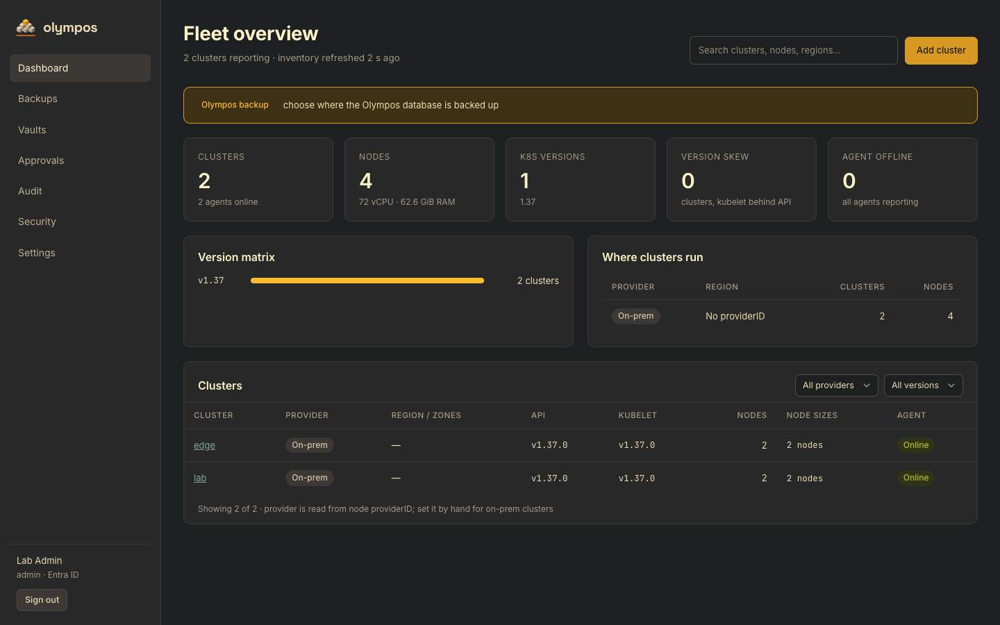
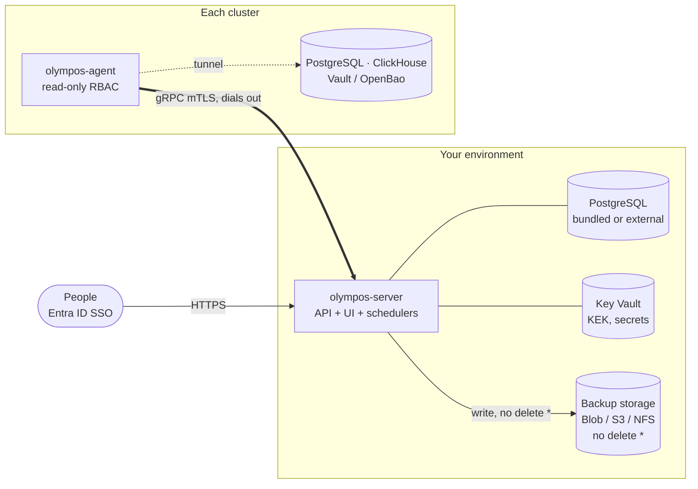
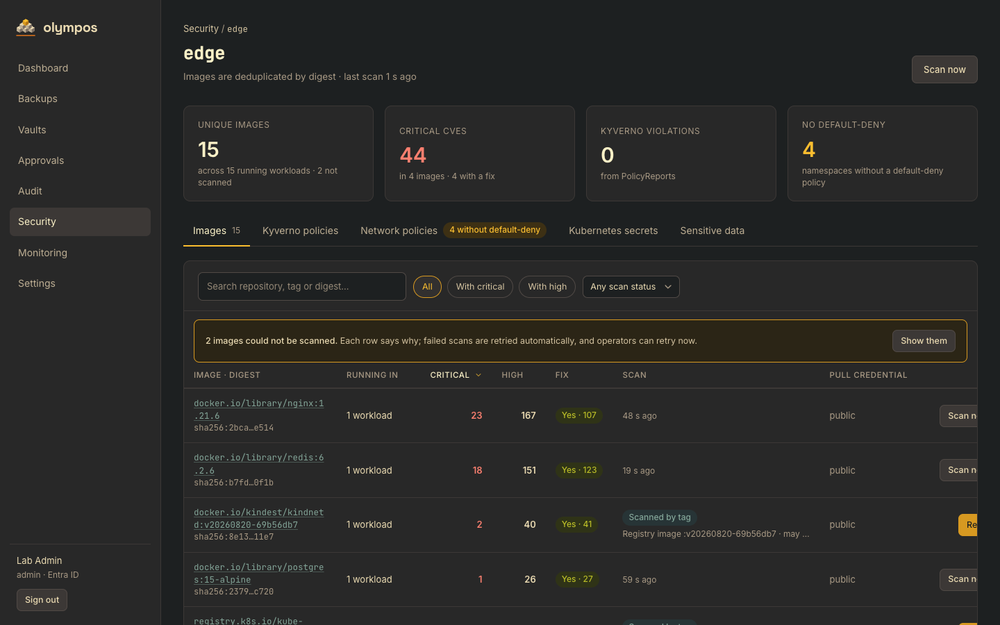
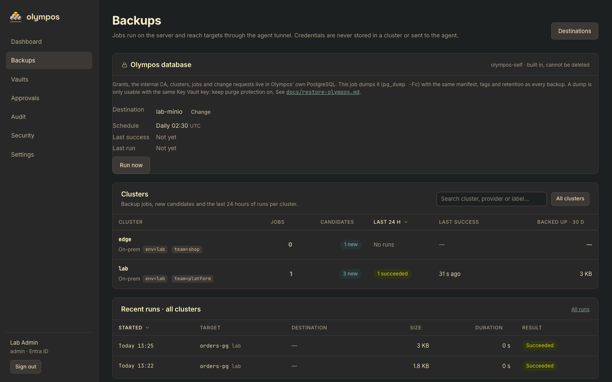
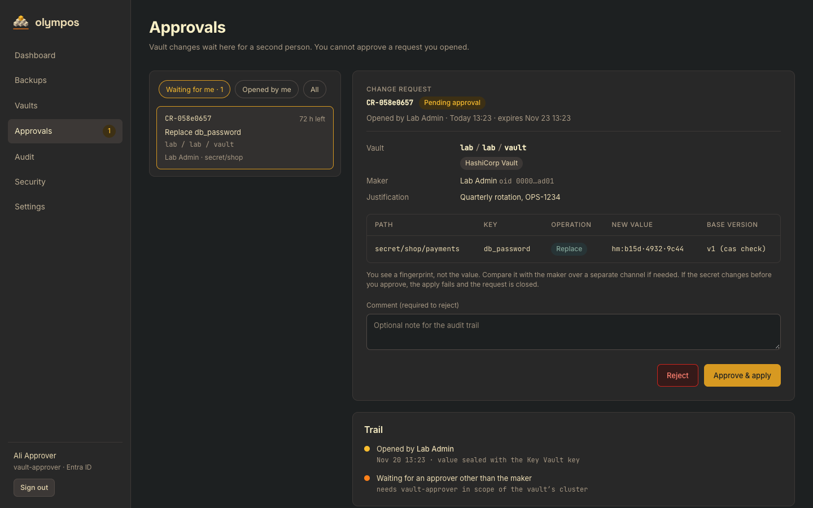

<p align="center"></p>

<h1 align="center">Olympos</h1>

<p align="center">Backups, Vault change control, audits and security for a fleet of Kubernetes clusters — self-hosted,
with an agent that only ever dials out.</p>

Olympos gives platform teams one place for the chores every cluster needs: it inventories the fleet, backs up
PostgreSQL, ClickHouse and Vault/OpenBao on a schedule to storage it cannot delete from, changes Vault
secrets only through maker/checker approval, runs kubescape, polaris and kube-bench, and shows running images
with their CVEs, Kyverno violations, NetworkPolicy gaps and credentials left in ConfigMaps. One server runs in
your environment (Kubernetes or a systemd VM); a small, read-only agent per cluster connects out to it over
mTLS. Credentials are never stored in a cluster or sent to the agent, and the agent has no listening port.
The agent cannot read Secret values other than its own identity. An optional inventory lists Secret metadata
(names, key names) only; it is off by default, and Kubernetes has no metadata-only permission, so with it on a
stolen agent token could read values ([trade-offs](docs/security-review-v0.1.md#accepted-trade-offs)).



## Architecture



\* Azure Blob (SAS) and S3 (policy) credentials cannot delete; a file system cannot enforce that, so NFS
destinations show a permanent warning and need storage-side snapshots or WORM.

- **Server**: Go, PostgreSQL, React SPA. Backups run on the server and reach targets through a byte tunnel the
  agent opens on request. In `e2e-tls` mode (default) the server speaks TLS end to end and the agent sees
  ciphertext; a PostgreSQL target without TLS is backed up only with SCRAM, so the agent sees the data but
  never the password, and the target is flagged `tls.missing`.
- **Agent**: distroless, read-only ClusterRole, discovery by Service annotations, reports state snapshots.
- **Security model** (details in [docs/security-model.md](docs/security-model.md)): maker ≠ checker for every
  Vault change, envelope encryption with a Key Vault KEK, blob credentials without delete, no password over
  plaintext in `e2e-tls` mode, dev login compiled out of release builds, signed releases with SBOMs.

| Security | Backups | Approvals |
|---|---|---|
|  |  |  |

## Quick start (kind)

Requirements: Docker, [kind](https://kind.sigs.k8s.io), Helm, Go. This builds the images, creates a two-node
kind cluster with PostgreSQL, ClickHouse, Vault, OpenBao, Azurite and MinIO, installs the server (development
build: local key vault, dev login) and enrolls nothing:

```bash
SETUP_ONLY=1 ./test/e2e/run.sh
open http://127.0.0.1:28080/auth/dev-login?oid=00000000-0000-0000-0000-00000000ad01&name=Admin
```

Then *Dashboard › Add cluster*, run the generated Helm command against the lab
(`KUBECONFIG=test/e2e/.work/kubeconfig`), and back up `orders-pg` from *Backups*. `./test/e2e/env.sh` builds a
browsable lab with two clusters; `./test/e2e/run.sh` runs the whole e2e suite.

## Install

- Kubernetes: [docs/install.md](docs/install.md) (Helm; bundled PostgreSQL by default).
- Linux VM as a systemd service: [docs/install-systemd.md](docs/install-systemd.md) (`.deb`, `.rpm`, tarball).
- Verify release signatures before installing: [docs/install.md#verifying-releases](docs/install.md#verifying-releases).

## Documentation

| Doc | |
|---|---|
| [SPEC.md](SPEC.md) | The specification (source of truth) |
| [docs/security-model.md](docs/security-model.md) | Trust boundaries and how each property is enforced |
| [docs/restore.md](docs/restore.md) · [docs/restore-olympos.md](docs/restore-olympos.md) | Restoring targets · restoring Olympos itself |
| [docs/runbooks/vault-break-glass.md](docs/runbooks/vault-break-glass.md) | Vault break-glass |
| [docs/openapi.yaml](docs/openapi.yaml) | REST API |
| [docs/development.md](docs/development.md) | Conventions, tests, migrations |
| [docs/spec-changes.md](docs/spec-changes.md) | Decisions that changed SPEC MUSTs |

## Development

```bash
make dev-db && OLYMPOS_REQUIRE_DB=1 go test -tags dev ./...   # unit + integration (dev build)
make test-release                                             # release build checks
cd web && pnpm install && pnpm test && pnpm build             # SPA
./test/e2e/run.sh                                             # kind e2e (M1–M7)
```

See [CONTRIBUTING.md](CONTRIBUTING.md). Report vulnerabilities privately: [SECURITY.md](SECURITY.md).
Versioning follows [SemVer](https://semver.org); changes are listed in [CHANGELOG.md](CHANGELOG.md).

## License

[Apache License 2.0](LICENSE).
