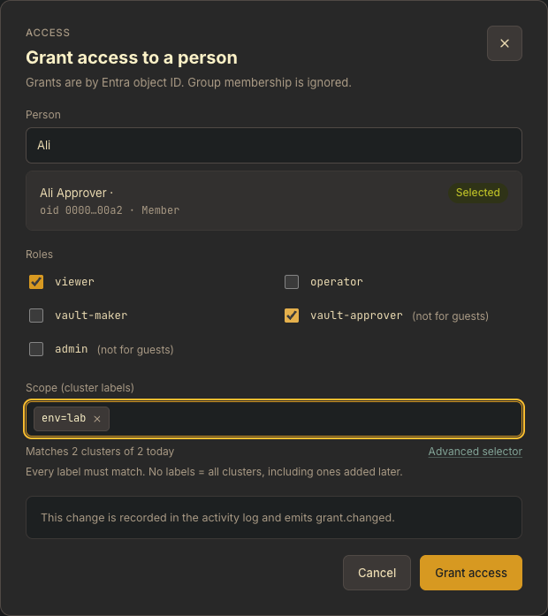
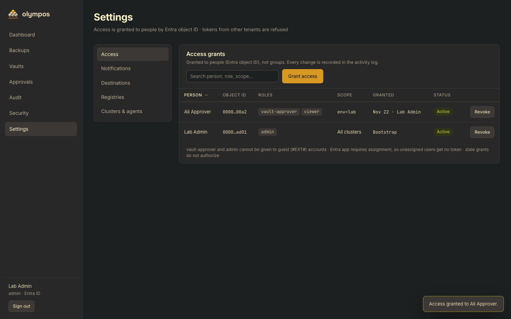

# Access: people, roles and scopes

People sign in with Microsoft Entra ID. Olympos decides what each person can do from its **own grants**,
stored by Entra object ID. Entra group membership is ignored.

## Roles

| Role | Can |
|---|---|
| `viewer` | Read everything except secret values: inventory, backups, runs, audits, findings, security, the activity log |
| `operator` | Everything a viewer can, plus configure and run backups, audits and image scans, and route notifications |
| `vault-maker` | Read, and open Vault change requests |
| `vault-approver` | Read, and approve or reject change requests **opened by someone else** |
| `admin` | All of the above, plus grants, clusters and agents, destinations, registries, Vault configuration, and accepting changed target TLS names |

Nobody sees a secret value: not the maker, not the approver, not an admin. A change request shows the keys,
the operation and an HMAC fingerprint of the new value.

## Scopes

Every grant has a **scope**: `all`, or a selector over the labels you give clusters in Olympos (*Add cluster*
or *Settings › Clusters & agents*). It uses Kubernetes label selector syntax:

| Scope | Covers |
|---|---|
| `all` | Every cluster, including ones added later |
| `env=prod` | Clusters labelled `env=prod` |
| `env=prod,team=payments` | Clusters with both labels |
| `team in (payments,shop)` | Clusters whose `team` is either value |

A grant only applies to clusters its scope matches. Objects outside it answer *not found*, as if they did not
exist. Every cluster also has the label `olympos.io/cluster=<name>`, so `olympos.io/cluster=prod-weu-01`
scopes a grant to one cluster.

Some objects belong to no cluster, so changing them needs a role with scope `all`:

| Change | Needs |
|---|---|
| Grants, destinations, registries, cluster enrollment, where raw audit reports go, the Olympos database backup | `admin` with scope `all` |
| Audit schedules, notification channels and routing | `operator` (or `admin`) with scope `all` |

Destinations and notification channels are readable by every signed-in person (names, kinds, endpoints,
last test result; never credentials), because every job and schedule form offers them. See the
[accepted trade-offs](security-review-v0.1.md#accepted-trade-offs).

## Granting access

1. The person signs in once. Until they have a grant they see *no access*; that first sign-in records them
   in Olympos.
2. An admin opens **Settings › Access › Grant access**, searches the person by name or e-mail (the search
   uses Microsoft Graph), ticks one or more roles and sets the scope. The dialog shows how many clusters the
   scope matches today.

Each grant is a separate row; a person can hold several roles with different scopes. Grants and revokes are
recorded in the activity log (`grant.created`, `grant.revoked`) and send the `grant.changed` notification.
Olympos refuses to revoke the last `admin` grant with scope `all`; grant admin to someone else first.

### The first admin

On a new installation nobody has a grant. The object IDs in `bootstrapAdmins` (server configuration) get
`admin` with scope `all` the first time anyone signs in, **only while there are no grants at all**. After
that, change admins in *Settings › Access*; editing `bootstrapAdmins` has no effect any more.

Find your object ID in the Entra admin center (*Users › your user › Object ID*) or with
`az ad signed-in-user show --query id -o tsv`.

## Guests, disabled and deleted accounts

- **Guests** (Entra B2B, `userType: Guest` or `#EXT#` in the UPN) cannot be given `vault-approver` or
  `admin`, and can never approve a change request, whatever grant they hold.
- **Disabled or deleted accounts**: once a day Olympos asks Microsoft Graph about every person with a grant.
  Grants of accounts that are disabled or gone become **stale** and stop authorizing immediately. They stay
  visible in *Settings › Access* until revoked.
- In Entra, set *Assignment required* on the Olympos enterprise application and assign the people who may
  sign in ([install](install.md#entra-id)). That is a second gate in front of Olympos' own grants.

## Maker and checker

Every Vault change needs two different people: the maker opens the request, someone else with
`vault-approver` in the vault's cluster scope approves it. Olympos compares people by tenant and object ID,
in code and in the database, and no role bypasses it: an admin cannot approve their own request either.
[Getting started](getting-started.md#8-change-a-secret-with-approval) shows the whole flow.
