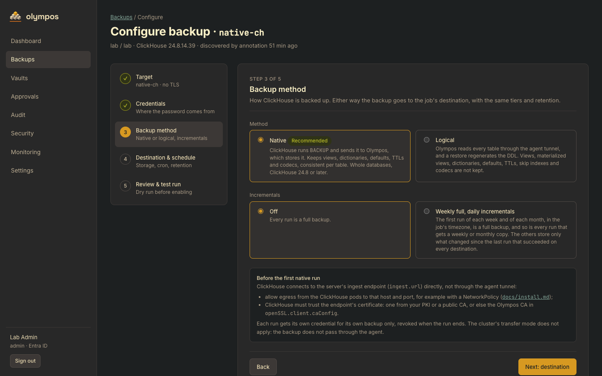
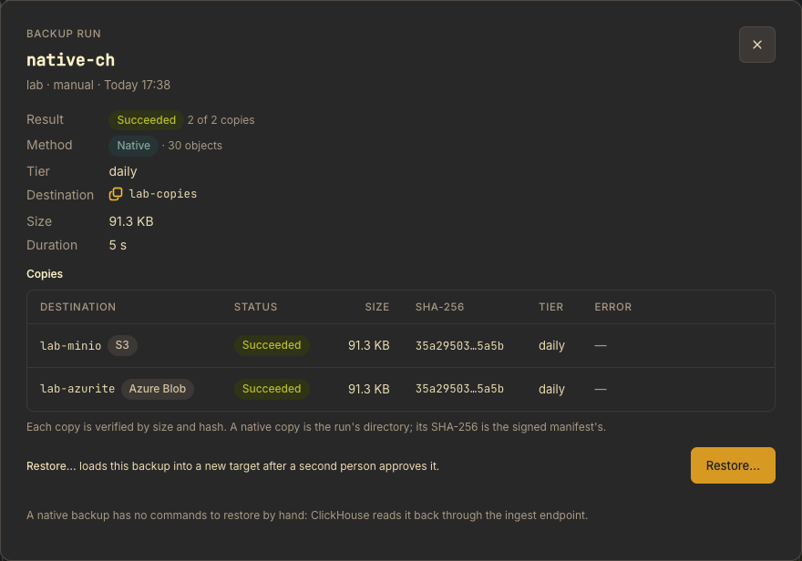

# ClickHouse backups: native and logical

A ClickHouse job takes its backups in one of two ways, its **method**: the *Method* step of the backup wizard,
or `engine_options.method` (`native` or `logical`) in the API. Both write to the job's destination or
destination group, with the same tiers, retention and "the server never deletes" as every other backup. This
page compares them and explains what a native backup needs, keeps and does.

## Native or logical

| | Native | Logical |
|---|---|---|
| How | ClickHouse runs its own `BACKUP` and sends the files to the Olympos server's ingest endpoint, which stores them | The server reads every table through the agent tunnel (`SELECT … FORMAT Native` per partition) and writes one zip |
| ClickHouse | 24.8 or later | Any version Olympos supports |
| Server setting | `ingest.url` ([install](install.md#5-native-clickhouse-backups-optional)) | None |
| Kept by a restore | The definitions as they were: tables with their codecs, TTLs, defaults, indexes, projections and settings; views, materialized views and dictionaries. What the [restore allowlist](restore.md#a-native-backup) cannot prove harmless is left out and listed | Databases and tables with their data; Olympos generates the DDL. Views, materialized views, dictionaries and the secondary table features are listed for you to re-apply |
| Consistency | ClickHouse's snapshot, consistent per table | One query per partition: a table that changes during the run is not read at one point in time |
| What is backed up | Whole databases | Databases, or a list of tables |
| Incrementals | Optional: a full each week, daily incrementals | No: every run is a full backup |
| Network | The backup data does not use the tunnel: ClickHouse connects to the endpoint directly over HTTPS, and the cluster needs egress to it. The `BACKUP` statement does, in the cluster's transfer mode (in `compressed` mode the run's credential crosses the agent in the clear; see the [security model](security-model.md#native-clickhouse-backups-the-ingest-endpoint)) | Through the agent tunnel, in the cluster's transfer mode |
| A partial run (a destination failed) | Not repaired: the next run is a full backup | Repaired: the missing copies are written again |
| Restore | From the UI only: a native run has no commands to restore by hand | From the UI, or by hand with the run's commands ([Restore by hand](restore.md#clickhouse)) |

New ClickHouse jobs start on **Native** (marked *Recommended* in the wizard) when the endpoint is on and the
target runs 24.8 or later.



A job created before native backups existed stays logical until you change its
method. A job that backs up only some tables (`tables`, set through the API) cannot be native: the API refuses
the combination, because a native run takes whole databases.

## What a native backup needs

- **The ingest endpoint.** `ingest.url` turns it on; without it the server opens no ingest port and the wizard
  offers only *Logical*. The endpoint needs a single server instance. Setting it up, its certificate and the
  Key Vault key that signs the backups:
  [Installing › Native ClickHouse backups](install.md#5-native-clickhouse-backups-optional).
- **Egress from the ClickHouse pods** to the host and port of `ingest.url`, for example with a NetworkPolicy
  ([example](install.md#egress-from-the-clickhouse-pods)).
- **A ClickHouse that trusts the endpoint's certificate**: one from your PKI or a public CA, or else the
  Olympos CA in ClickHouse's `openSSL.client` configuration ([how](install.md#clickhouse-trusts-the-endpoint)).
- **ClickHouse 24.8 or later.** An older target fails the run with *native backups need ClickHouse 24.8 or
  later, and this target runs …*; use the logical method for it, or upgrade it.
- **A target that is not sharded.** A `BACKUP` saves only the shard it runs on, so the run is refused when a
  selected database has a `Distributed` table, or when the server is in a cluster of `system.clusters` with
  more than one shard. A cluster named exactly `all-sharded` is not counted: the Altinity operator creates it
  on every installation, with each replica as a shard, so a replicated, unsharded installation has it too. A
  really sharded installation is still refused by its own cluster and by its `Distributed` tables; only a
  cluster of your own named `all-sharded`, really sharded, with no `Distributed` table in the selected
  databases, would back up one shard. Use the logical method for sharded targets.
- **The backup user's privileges.** ClickHouse's `BACKUP` privilege on the databases; no `SELECT` on them and
  no `S3` grant. Olympos also reads `system.tables`, `system.clusters`, `system.parts`, `system.processes` and
  `system.backups` on the target. Every user can read these by default. When the server sets
  `select_from_system_db_requires_grant`, grant `SELECT` on the last four (`system.tables` stays readable and
  lists the tables the user may back up): without `system.parts` the run fails with
  `clickhouse: size of the databases: …`, without `system.clusters` with `clickhouse: read system.clusters: …`,
  without `system.backups` with `clickhouse: the native backup may still be running on the target …`, and
  without `system.processes` it cannot end a backup an earlier run left running. For the database `shop`:

  ```sql
  CREATE USER backup IDENTIFIED BY '…';
  GRANT BACKUP ON shop.* TO backup;
  GRANT SELECT ON system.parts TO backup;
  GRANT SELECT ON system.clusters TO backup;
  GRANT SELECT ON system.backups TO backup;
  GRANT SELECT ON system.processes TO backup;
  ```

  The wizard's *Test connection* checks what the logical method needs (`SHOW` and `SELECT` on every table) and
  lists those as missing for this user; the native run does not need them. The dry run tests the native method.

The wizard's dry run (*Review & test run*) tests all of this in seconds: it is a `BACKUP` of the definitions
only, through the endpoint, to the destinations ([configuration › Dry runs](configuration.md#ingest)).

## What a native backup keeps

A native run backs up the databases of the job (or every database the backup user sees, except the system
databases), with ClickHouse's own format: every table's data parts, and the definition of every database,
table, view, materialized view and dictionary. The run is a directory in the destination,
`<prefix>/<cluster>/<namespace>/<service>/clickhouse/YYYY/MM/DD/<run-id>/`, with ClickHouse's files in it
(`.backup`, `metadata/…`, `data/…`), and its manifest `<run-id>.manifest.json` next to it, which holds the
signed native manifest (`details.native`).



The manifest lists every file the backup holds, with its size and SHA-256, the databases and their objects,
and the rows of every table, and it is **signed** with a Key Vault key. Only what ClickHouse declares in its
`.backup` file is signed: a file the client stored besides is left out of the manifest, stays tagged
`incomplete` (the lifecycle rule removes it) and is logged with its name. A run whose manifest does not verify
is not restored and is not the base of an incremental.

Each file is written to every destination of the job as it arrives, tagged `olympos-state=incomplete`, and
tagged `complete` with its tier once the signed manifest is written. A run that dies before that leaves
incomplete files, which a lifecycle rule removes
([install › Backup storage](install.md#4-backup-storage-hardening-required)).

## Incrementals

With *Weekly full, daily incrementals* (`engine_options.incremental: weekly_full_daily`) the first run of each
week (Monday, in the job's time zone) and of each month is a full backup, and so is every run that gets a
weekly or monthly copy; the others store only what changed since the latest run. So a chain (a full and the
incrementals on it) spans at most one week and at most 32 runs, and only daily copies depend on one. When the
latest run cannot be a base (it was partial, an incremental after it failed, it is not on every destination of
the run, or its manifests do not verify), the run is a full backup instead. The details and how the chain is
kept as long as its incrementals: [configuration › `ingest`](configuration.md#ingest), *Incrementals* and
*Retention of incrementals*.

**Weekly retention must be at least daily retention plus 7 days, plus the job's retry window** (half the time
to the job's next scheduled run: 12 hours for a daily job). A run retried after a lost agent keeps its
scheduled time, so it can be written up to that much later than the week it belongs to
([install › Backup storage](install.md#4-backup-storage-hardening-required)).

**Keep `ingest.url` as it is.** Each incremental names its base by its URL under the endpoint it was taken
through, and a restore from the UI refuses a chain with an incremental taken through another `ingest.url` than
the current one, naming that URL: set `ingest.url` back to restore it. A full backup restores whatever URL it
was taken through. If you must change the URL, change it just before the first run of a week, so that only the
incrementals of earlier weeks name the old one.

## Limits

- **Bytes per run.** A run may write the largest of twice the job's last full (at most twice what its databases
  hold), 1.5 times what its databases hold, and 1 GiB, or `ingest.maxRunBytes` when set
  ([configuration › `ingest`](configuration.md#ingest)).
- **Files per run.** A backup of more than about 250,000 files fails: its `.backup` file, which lists every
  file, would be over the 64 MiB the endpoint keeps of it, and the run is stopped (`capture limit`). A wide
  part of a MergeTree table has two files per column and a few more, so the limit is about parts and columns,
  not bytes.
- **Requests per second.** Olympos has ClickHouse send at most 150 write and list requests and 40 reads a
  second per run (the query settings `s3_max_put_rps` and `s3_max_get_rps`, with bursts of the same size),
  under the endpoint's 200 requests a second. Large files are not slowed by this, but a backup of many small
  files is: 250,000 files take at least about 28 minutes. A client that stays over 200 a second for 30 seconds
  in a row is stopped (`rate`); a shorter burst is told to slow down and the run goes on. A restore has the
  same limits the other way round: 150 reads and 40 write and list requests a second.
- **Duration.** A run's credential lasts `ingest.maxRunDuration` (6 hours by default); a run still going then
  is ended.
- **Runs at once.** At most `ingest.maxRuns` (4) native backups and restores hold an ingest session at the same
  time; a backup run that finds none free fails (the next scheduled run tries again); a restore fails and can be
  opened again.

## When a native run fails

The run's error names the cause; the most common ones:

| Error | What to do |
|---|---|
| `native backups need ClickHouse 24.8 or later, and this target runs …` | Use the logical method, or upgrade the target. |
| `native backups of sharded targets are not supported: …` | Use the logical method. The error names the `Distributed` tables or the cluster. |
| `clickhouse: size of the databases: …` | Grant `SELECT` on `system.parts` ([above](#what-a-native-backup-needs)), or set `ingest.maxRunBytes`, which skips this query. |
| `native byte limit: the run wrote more than …` | Set `ingest.maxRunBytes` above the largest backup you expect ([configuration](configuration.md#ingest)). |
| a TLS or connection error from ClickHouse in `BACKUP` | ClickHouse cannot reach the endpoint or does not trust its certificate: check the egress and `openSSL.client` ([install](install.md#5-native-clickhouse-backups-optional)). |
| `the backup's manifest does not verify` (a restore), or a full where an incremental was due (the server log: *the base chain cannot be used*) | The cause is in the server log. Key Vault did not answer, or the server's identity cannot read the manifest key (the server verifies fail-closed): check Key Vault and `keys/get` on the key, then check again (a backup run needs nothing: the next one tries the chain again). The key version that signed the manifest is disabled or deleted, or the manifest or a link of its chain was changed: the backup cannot be restored or be the base of an incremental (the job's next run is a full backup). The destination could not be read: check it, then check again. |

A run that dies while its `BACKUP` still runs on the target leaves it there; the next native run on that server
ends it, and the error names the `KILL QUERY` to run by hand ([configuration › Backups left
running](configuration.md#ingest)).

## Restoring a native backup

A native backup is restored from the UI into a new ClickHouse 24.8 or later that also reaches the endpoint and
trusts its certificate: [Restoring backups › A native backup](restore.md#a-native-backup). While the restore
runs, the target reads through the endpoint only what it restores: the backup's file lists and the definitions
and data of the selected databases and the objects it creates, never the definition of an object left out. After the `RESTORE`, an object that is not the
definition the checker approved is dropped and the restore fails, naming it. An object that calls `encrypt`,
`decrypt`, `tryDecrypt`, `aes_encrypt_mysql` or `aes_decrypt_mysql` with anything but literals and column names
from the second argument on is left out, with the reason: ClickHouse hides those arguments on the target, so the
check after the restore cannot compare them ([what is left out](restore.md#a-native-backup)).
