# Getting started: Olympos on your laptop

This guide runs Olympos in a local lab and walks through what a new installation does: add clusters, back
up a database, write each backup to two destinations, change a Vault secret with a second person's
approval, restore a backup into a new server, run audits and image scans, and watch a service from every
cluster. It takes about 45 minutes and needs no Azure account.

The lab uses a **development build**: sign-in without Entra ID (dev login) and a local key vault instead of
Azure Key Vault. Release builds have neither. To install Olympos for real, see
[Installing on Kubernetes](install.md) or [Installing on a Linux VM](install-systemd.md).

Every screenshot here comes from this lab, taken by `web/scripts/docs-tour.mjs`, which runs the same steps.

## 1. Start the lab

You need Docker, [kind](https://kind.sigs.k8s.io), `kubectl`, Helm, Go and `openssl`. The lab runs four kind
nodes at once, so give Docker a generous memory limit. From the repository root:

```bash
./test/e2e/env.sh
```

The first run builds the server and agent images, which takes a while; later runs reuse them. It creates two
kind clusters, each with its own kubeconfig; your current kube context is not touched:

| Cluster | Runs |
|---|---|
| `olympos-lab` | the Olympos server, its PostgreSQL, and targets to back up: PostgreSQL `orders-pg`, ClickHouse `metrics-ch`, HashiCorp Vault and OpenBao (TLS, raft), Azurite and MinIO as backup storage, Kyverno |
| `olympos-edge` | shop workloads: a TLS PostgreSQL `payments-pg` and deliberately old `nginx`/`redis` images |

Both also run `synth-web`, a small web service that answers every `*.olympos-lab.test` name, for synthetic
monitoring (step 12).

No agent is enrolled: adding the clusters is the first step below. When the script finishes it prints the
sign-in links and the lab's generated values (Vault root tokens, the Azurite SAS) and writes them to
`test/e2e/.work/ENV.md`. Run it again at any time to reset Olympos to empty.

## 2. Sign in

Open the admin's dev login: <http://127.0.0.1:28080/auth/dev-login?oid=00000000-0000-0000-0000-00000000ad01&name=Lab%20Admin>.
In a real installation people sign in with Entra ID, and only the IDs in `bootstrapAdmins` are admins at
first.

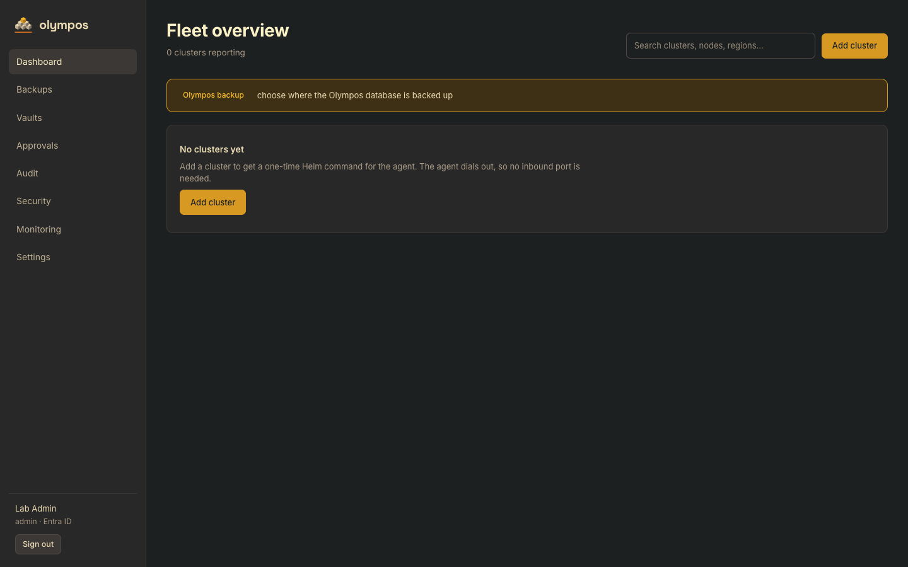

The banner asks where Olympos' own database is backed up; step 4 answers it.

## 3. Add your clusters

Each cluster gets an agent. The agent only dials out to the server, so the cluster needs no inbound port.

1. Choose **Add cluster**. Give the cluster a name and labels. Labels (`key=value`) decide who can see the
   cluster and which audits and grants apply to it; `olympos.io/cluster=<name>` is added for you.
   kube-bench needs a privileged Job per node, so it is off unless you tick it.

   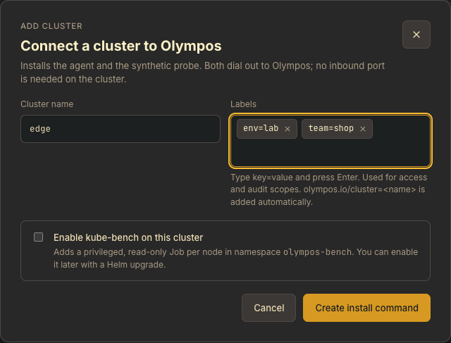

2. **Create install command** shows a Helm command with a one-time bootstrap token (valid for an hour,
   usable once; the token is masked in the image below). The command installs the agent and, next to it,
   the probe that runs [synthetic monitoring](synthetic-monitoring.md) scenarios. With Argo CD or Flux,
   the **GitOps** tab gives the same install as two steps instead
   ([Install with Argo CD or Flux](install.md#install-with-argo-cd-or-flux)).

   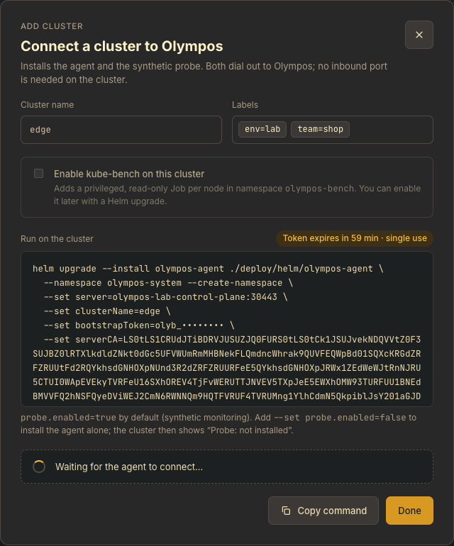

3. Run it against the cluster. In the lab:

   ```bash
   export KUBECONFIG=$PWD/test/e2e/.work/kubeconfig-env
   kubectl config use-context kind-olympos-edge
   # paste the command from the dialog
   ```

   The dialog waits until the agent connects and shows the cluster's Kubernetes version.

   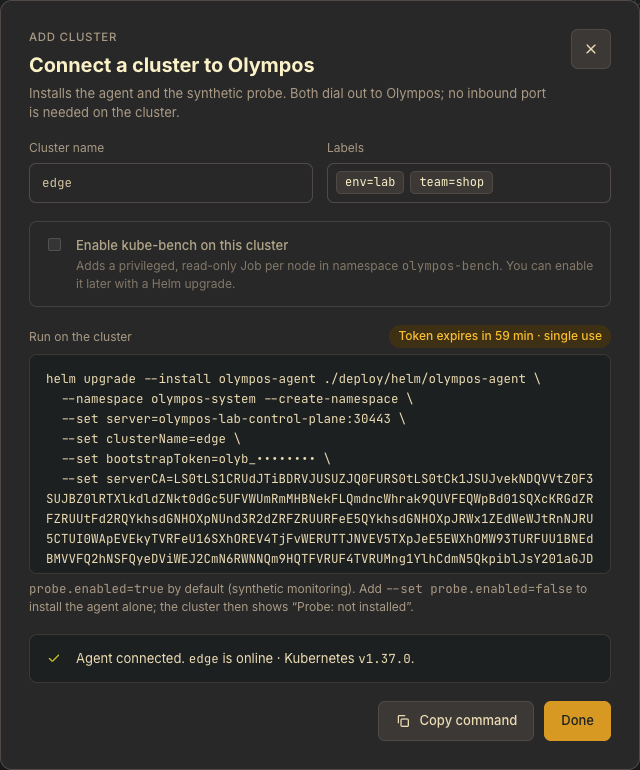

Add the second cluster the same way: name `lab`, labels `env=lab` and `team=platform`, tick **Enable
kube-bench**, and run its command in the `kind-olympos-lab` context. The Dashboard then shows the fleet:

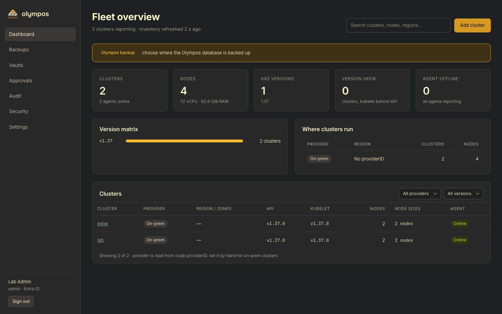

In a real installation the command installs the agent chart from `oci://ghcr.io/warewave-technology/charts`;
the lab installs the chart from the repository and the locally built image.

## 4. Add a backup destination

Backups go to Azure Blob, S3 (or an S3-compatible service) or NFS. Olympos writes but should not be able to
delete: retention is enforced by the storage (lifecycle rules or object lock), so a stolen Olympos
credential cannot erase backups.

Go to **Settings › Destinations › New destination** and enter the lab's MinIO, with a key that may write but
not delete:

| Field | Lab value |
|---|---|
| Kind | S3 / S3-compatible |
| Name | `lab-minio` |
| Endpoint override | `http://minio.olympos.svc:9000` |
| Region | `us-east-1` |
| Bucket | `backups` |
| Path-style addressing | on |
| Access key ID | `olympos-backup` |
| Secret key | **Store in Olympos**, `lab-backup-secret-key` |

In production prefer a **Key Vault reference** (`kv://<vault>/<secret>`): the secret stays in Key Vault and is
read when needed. *Store in Olympos* encrypts it with a Key Vault key (envelope encryption).

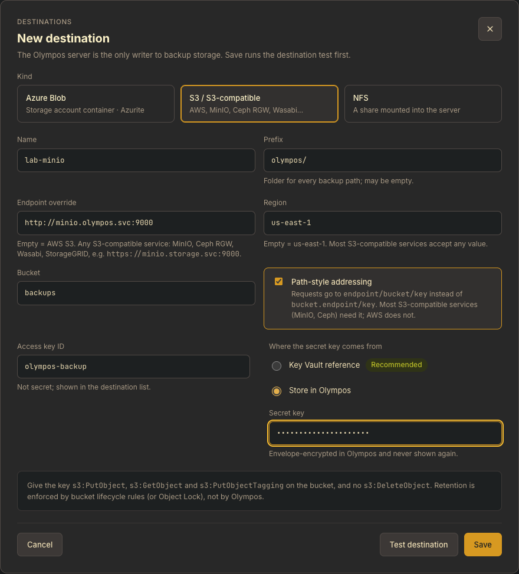

**Test destination** writes, reads and tags a probe object and checks that deleting it is refused. Save runs
the same test. A key that can delete is saved with a warning that stays on the destination.

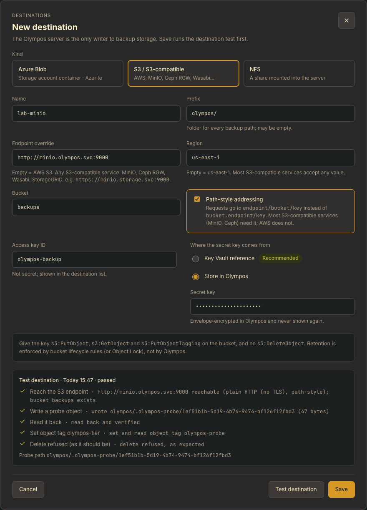

Then back up Olympos itself: on **Backups**, the *Olympos database* card picks a destination for the built-in
`olympos-self` job (daily at 02:30 UTC). The job cannot be deleted. Restoring it needs the same Key Vault key,
so keep purge protection on ([Restoring Olympos](restore-olympos.md)).

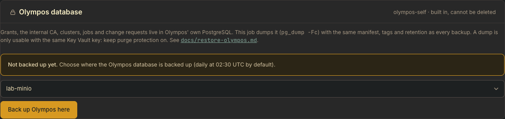

## 5. Back up a database

The agent finds databases by Service annotation (`olympos.io/backup: postgresql | clickhouse | vault`); they
show as candidates under **Backups › &lt;cluster&gt;**. Choose **Configure** next to `orders-pg` in the `lab`
cluster. The wizard has four steps.

1. **Target**: what the agent found. The TLS name (`olympos.io/tls-server-name`) is pinned when the target
   is first seen; if the annotation changes later, an admin of the cluster has to accept it.

   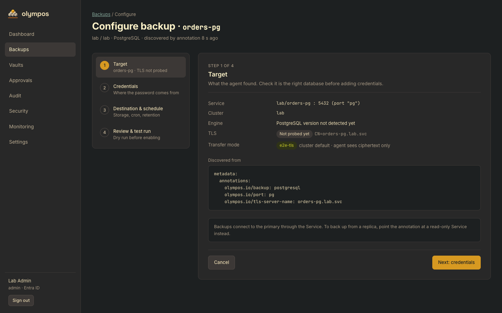

2. **Credentials**: in the lab, *Store in Olympos* with user `backup`, password `CANARY-lab-pg-password`.
   **Test connection** logs in through the agent tunnel and shows the server version, whether TLS was
   verified end to end, the databases it will dump and the privileges it found. PostgreSQL needs
   `pg_read_all_data` (or superuser).

   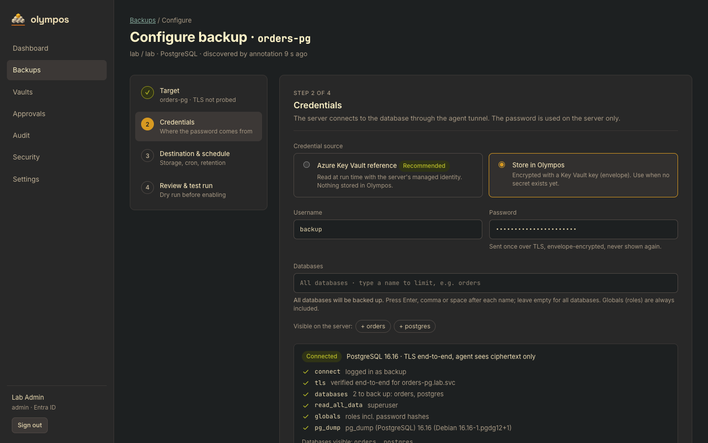

3. **Destination & schedule**: `lab-minio`, *Daily 02:00*, and how many daily, weekly and monthly backups
   to keep. Olympos tags each object with its tier; the storage's lifecycle rules delete old ones.

   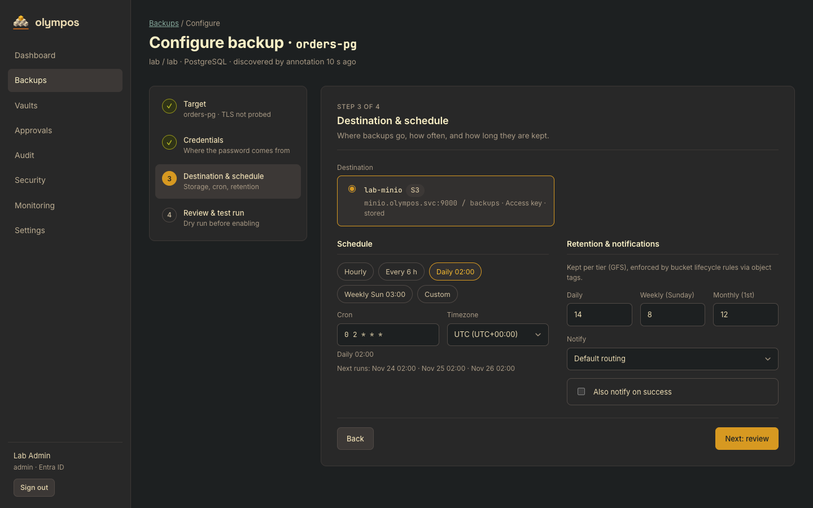

4. **Review & test run**: **Create job and run dry run** creates the job disabled and runs a schema-only
   backup end to end. **Enable backup** is available only after the dry run passes.

   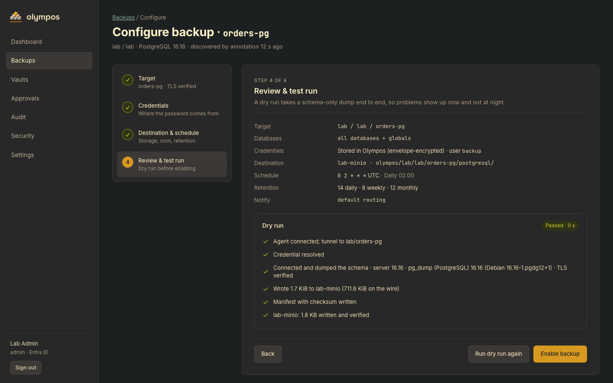

Start the first real backup with **Run now** on **Backups › Jobs**. Runs are listed under **Runs**:

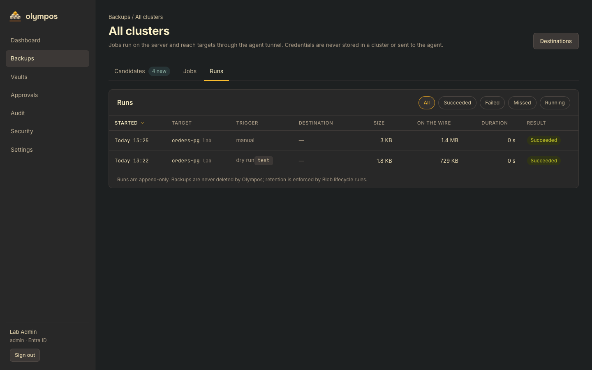

Open a successful run to see its details. **Restore…** loads it into a new server after a second person
approves ([step 9](#9-restore-a-backup-into-a-new-server)); below it are the commands to restore by hand,
filled in for exactly that backup: download, verify the checksum, restore. Both are described in
[Restore](restore.md).

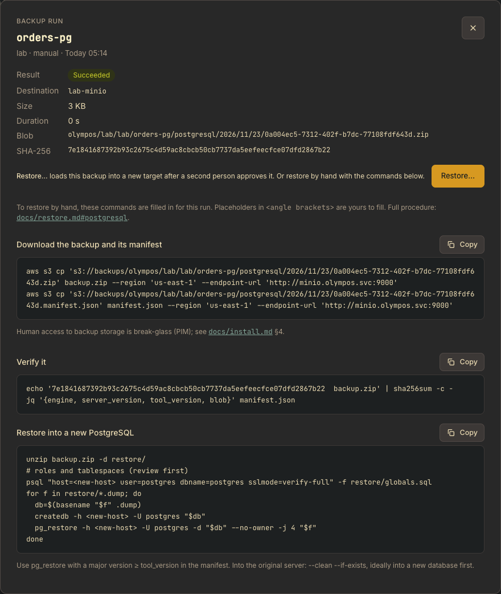

## 6. Write each backup to two destinations

A single copy of a backup is lost with its storage account, bucket or credential. A **destination group**
writes every run to two to four destinations: one dump, streamed to all of them at once, each copy checked
by size and SHA-256. The members can be of any kind, for example Azure Blob in your region and S3 or NFS
somewhere else.

1. **Add a second destination.** Under **Settings › Destinations › New destination**, add the lab's Azurite
   (an Azure Blob emulator). The SAS can read, create, write and tag, but not delete.

   | Field | Lab value |
   |---|---|
   | Kind | Azure Blob |
   | Name | `lab-azurite` |
   | Storage account | `devstoreaccount1` |
   | Container | `backups` |
   | Endpoint override | `http://azurite.olympos.svc:10000/devstoreaccount1` |
   | Authentication | **SAS token**, **Store in Olympos**, the `SAS:` value from `ENV.md` |

2. **Create the group.** Under **Groups** on the same page, choose **New group**, name it `lab-copies` and
   add `lab-minio` and `lab-azurite`. The first member is the copy the restore commands use by default.
   Two members that write to the same place (same container or bucket and prefix) are refused: that would
   not be a second copy.

   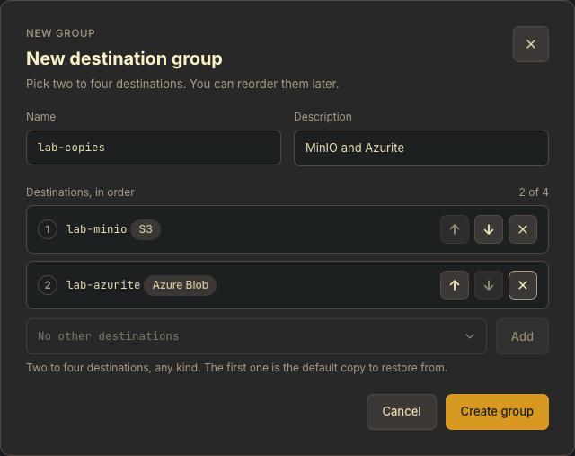

   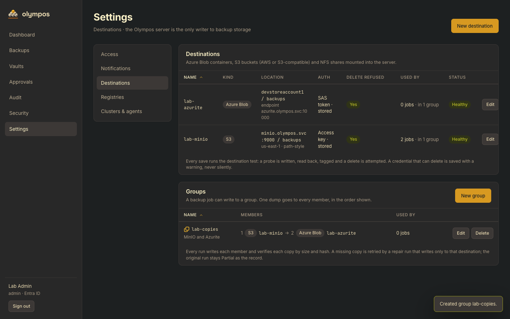

   A destination that is in a group cannot be deleted, and neither can a group that a job uses. A destination
   that holds copies of backup runs stays too, even when no job uses it any more: the runs' restore commands
   point at it (its *Delete* says how many runs). A member you add later gets only new runs; existing backups
   are not copied to it.

3. **Use the group in a job.** Configure `payments-pg` in the `edge` cluster as in step 5 (user `backup`,
   password `edge-pg-password`). In step 3 of the wizard, choose `lab-copies`. **Edit** on **Backups › Jobs**
   moves an existing job to a group the same way.

   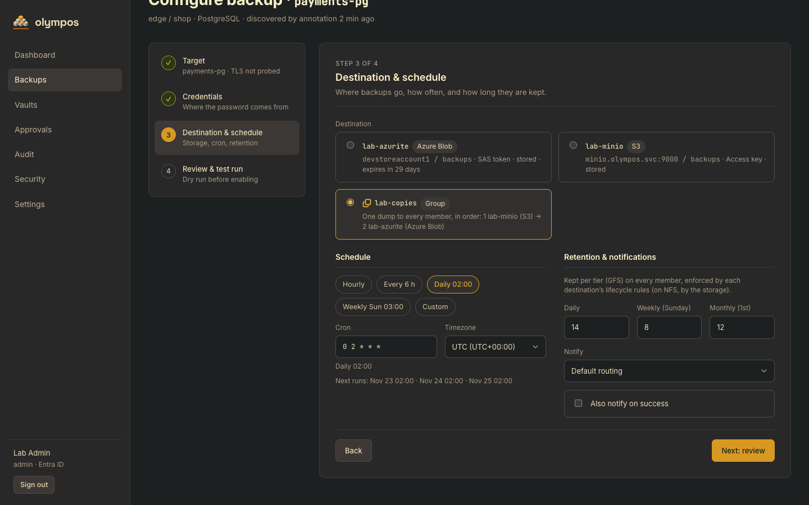

   The dry run writes to every member and checks each copy. **Enable backup** needs all of them.

   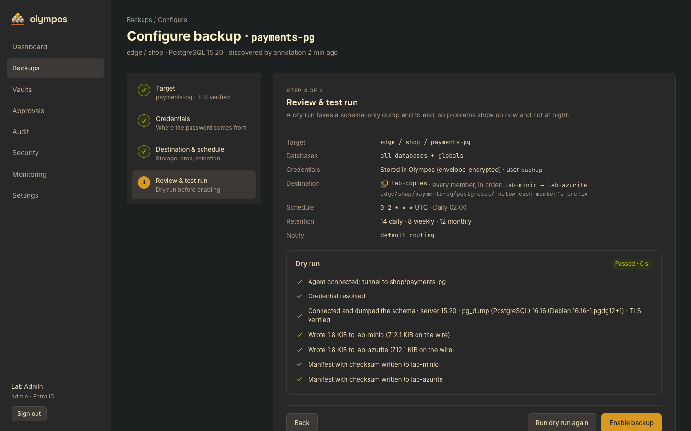

4. **Run it.** **Run now** on **Backups › Jobs**. The run's details list the **Copies**, one per destination,
   with the same SHA-256. **Restore from copy** chooses which copy the restore commands download. On
   **Backups › Jobs**, the job's *Destination* lists each member with the time of its last successful copy,
   so a member that keeps failing stands out. The *Olympos database* card shows the same for a group, and
   the copies of its last run.

   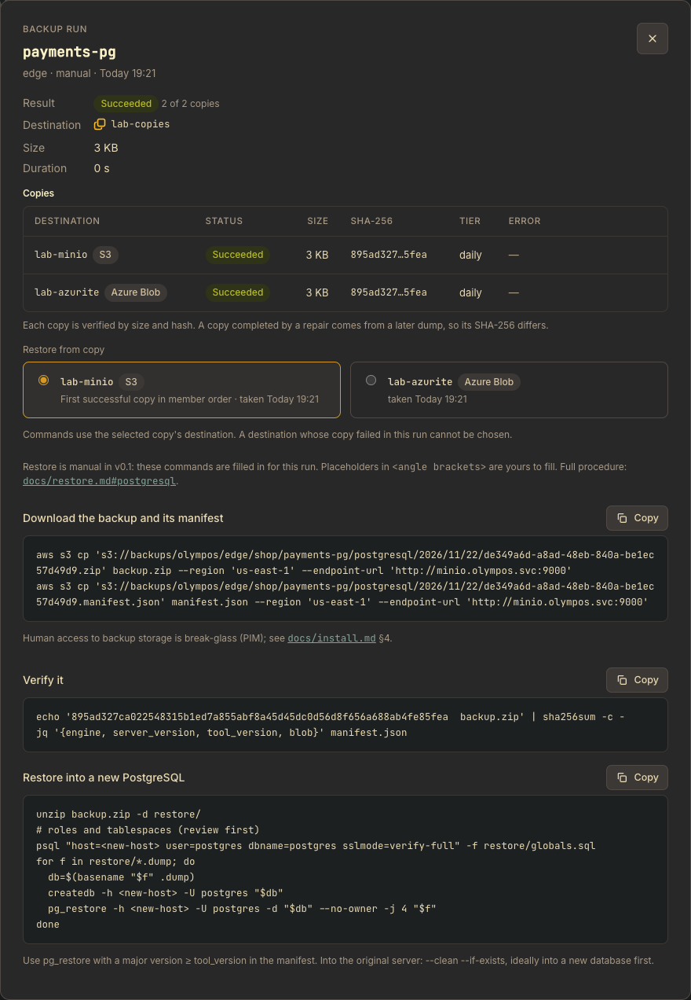

Retention stays with the storage: each destination's lifecycle rules delete by the `olympos-tier` tag.
Olympos decides the tier for each destination on its own, so copies of one run can have different tiers,
and a destination that missed some runs still gets its weekly and monthly copies.

The Olympos database can go to a group too: on **Backups**, choose **Change** on the *Olympos database*
card and pick `lab-copies` ([Restoring Olympos](restore-olympos.md)).

### When one destination fails

To take the next screenshots, Azurite was made unreachable for one run. The other destination still gets
its copy. The run ends **Partial** (amber, never green), the Dashboard shows *Backup incomplete* and
Olympos sends a `backup.partial` event
([Findings and events](findings-and-events.md#partial-backups-and-repairs)).


Olympos then queues a **repair run**: a new dump, written only to the destinations that are missing. It
waits 5 minutes, so a short outage can pass. Under **Runs** it is marked *Repair* and shows when it starts;
the partial run's details say *Repair queued: next attempt at …*.

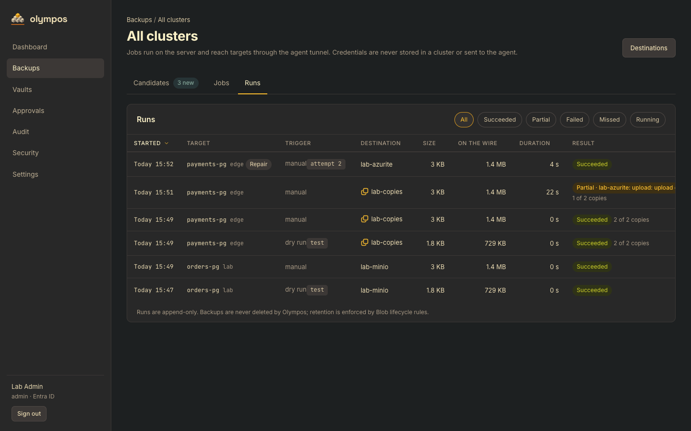

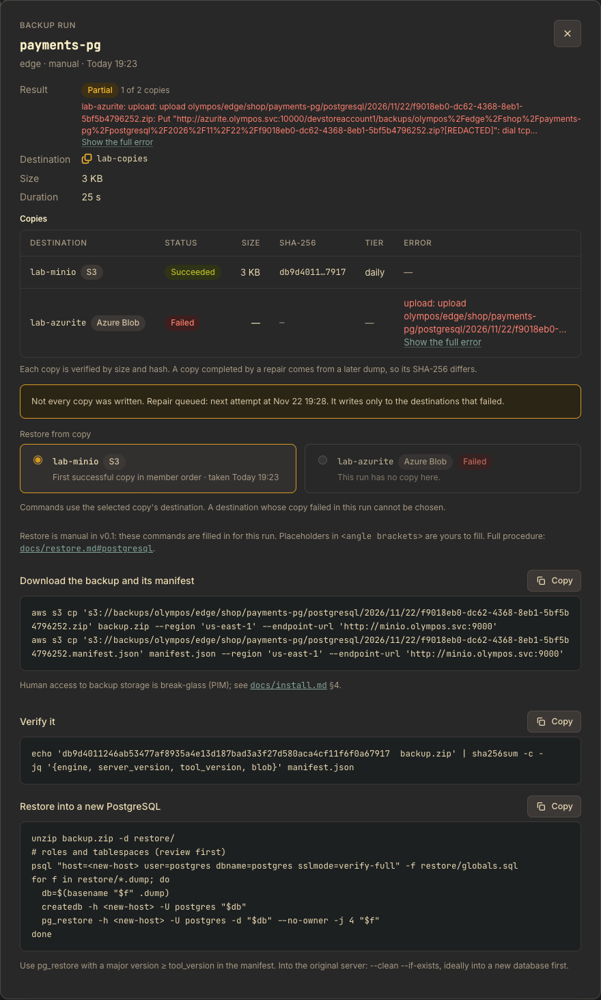

The partial run stays Partial, as the record of what happened, and once the repair has run, its details
say which copy the repair completed. When every missing copy is written, *Backup incomplete* goes away. A
repaired copy comes from a later dump, so its SHA-256 differs from the other copies.

If a repair fails too, the next one waits longer: the second repair starts 30 minutes after the first,
the third 2 hours after the second. Every repair must start inside the job's retry window (half the time
to its next scheduled run); one that would start later is not queued. When no repair is left, the last
one sends `backup.failed` with the missing destination, and the next scheduled run (or **Run now**) writes
to every member again. A repair waiting for its start does not block **Run now**.
[Troubleshooting](troubleshooting.md#a-backup-is-incomplete-partial) lists the usual causes.

To try it yourself, take Azurite off the network without losing its data, run the job, then put it back:

```bash
export KUBECONFIG=$PWD/test/e2e/.work/kubeconfig-env
# Point the Service at no pod: new connections are refused, the data stays.
kubectl --context kind-olympos-lab -n olympos patch service azurite --type merge \
  -p '{"spec":{"selector":{"app":"azurite-off"}}}'
sleep 100   # Olympos' idle connections to Azurite close after 90 s
# Backups › Jobs › Run now on payments-pg, wait until the run is Partial, then:
kubectl --context kind-olympos-lab -n olympos patch service azurite --type merge \
  -p '{"spec":{"selector":{"app":"azurite"}}}'
```

Do not scale Azurite to 0 instead: it keeps its data in memory, so the container and every backup in it
would be gone. The repair starts 5 minutes after the partial run.

## 7. Connect a Vault

Vaults are discovered like databases. On **Vaults**, select `vault` in the `lab` cluster and choose
**Configure**. Paste its root token from `ENV.md`, then **List KV mounts** and choose which KV v2 mounts
Olympos manages. Olympos creates an `olympos` policy (list paths, read key names, patch values, **no read of
values**) and an AppRole, then discards the root token. You can revoke it right away.

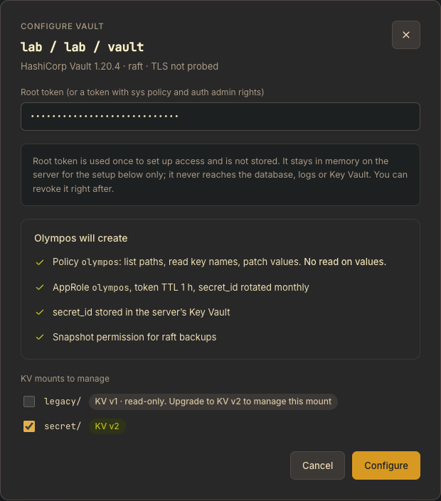

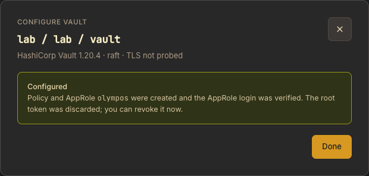

Olympos now shows the vault's paths and keys, never the values, not even to admins:

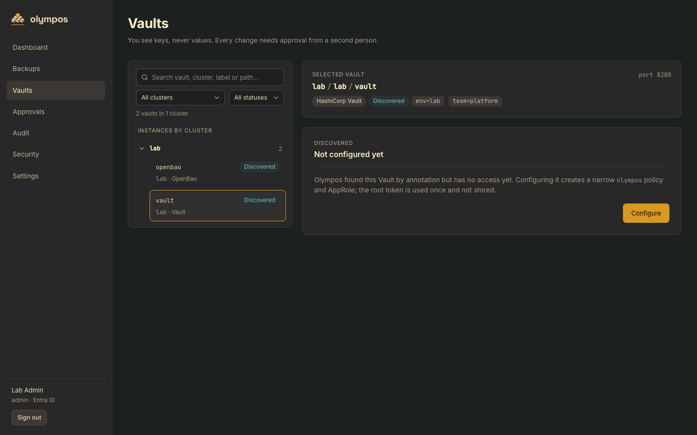

## 8. Change a secret with approval

Every Vault change needs a second person (maker/checker). Nobody can approve their own request, admins
included.

1. **Give someone approval rights.** Sign in once as the approver in a private window
   (<http://127.0.0.1:28080/auth/dev-login?oid=00000000-0000-0000-0000-0000000000a2&name=Ali%20Approver>);
   until a grant exists they see *no access*. As the admin, open **Settings › Access › Grant access**, find
   *Ali Approver*, tick `vault-approver` and limit the scope to the clusters labelled `env=lab`.

   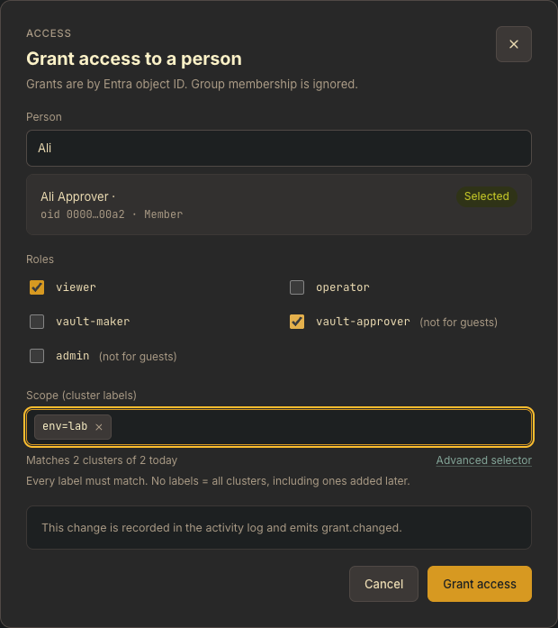

   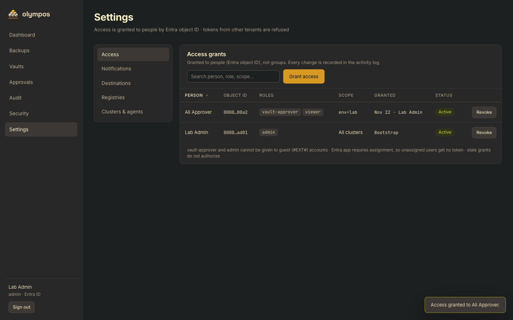

2. **Request the change.** As the admin, on the vault's `secret/shop/payments`, choose **Replace** next to
   `db_password`, enter the new value twice and a justification. The value is sealed with a Key Vault key
   until approved; after you submit, only its HMAC fingerprint is shown. Requests expire after 72 hours.

   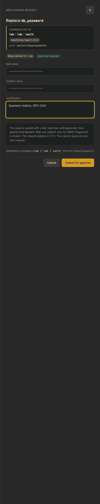

   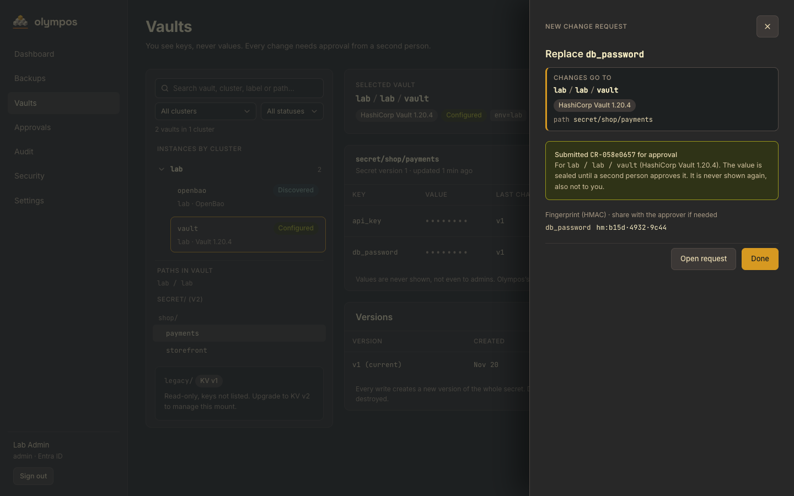

   On **Approvals** the maker can follow the request but has no **Approve** button:

   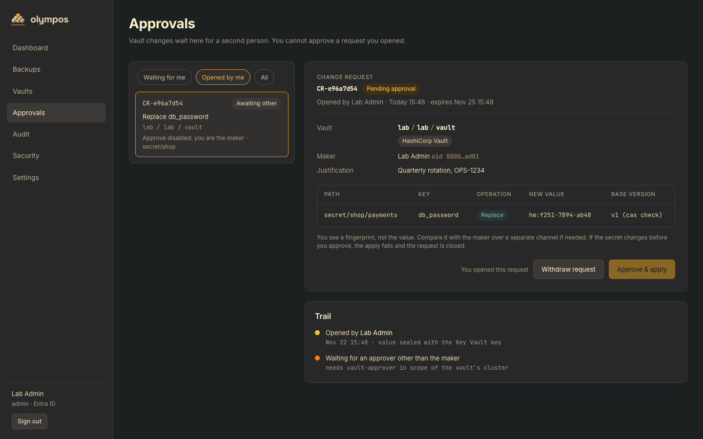

3. **Approve it.** As the approver, open **Approvals**. The request shows the key, the operation and the new
   value's fingerprint (compare it with the maker over another channel if needed). **Approve & apply**
   writes the change to Vault with a check-and-set on the version the maker saw: if the secret changed in
   between, the apply fails and the request is closed.

   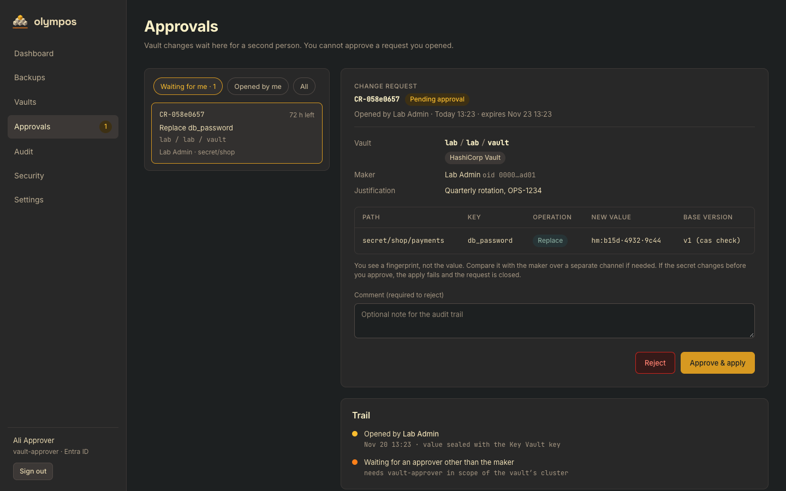

   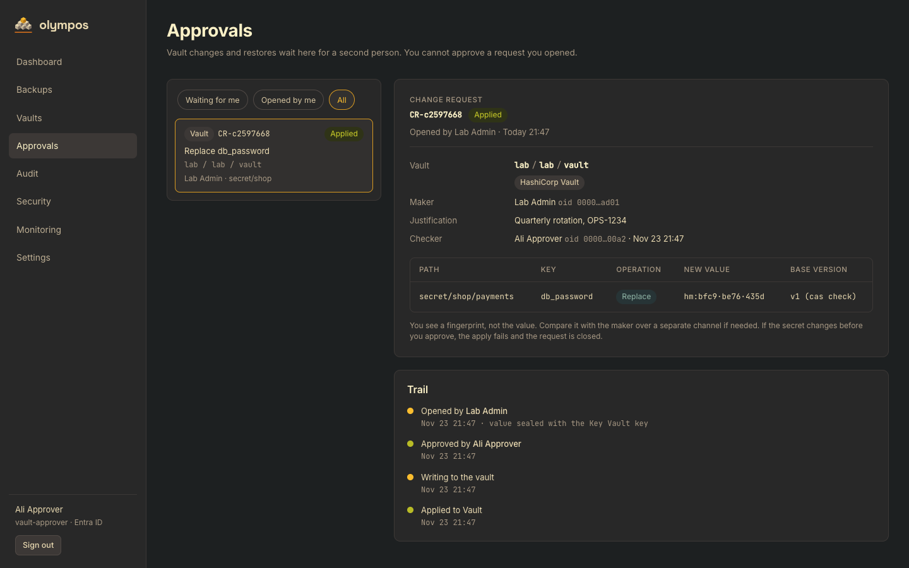

## 9. Restore a backup into a new server

In a disaster the database is gone and a backup must go into a **new** server quickly. The lab has three
new, empty servers in the `lab` namespace for that: `restore-pg` (PostgreSQL 16), `restore-ch` (ClickHouse)
and `restore-vault` (Vault, not configured in Olympos). Their logins are in `ENV.md`. Like Vault changes,
a restore needs a second person: the checker needs `operate` on both clusters, so first grant *Ali
Approver* the `operator` role for `env=lab` as well (**Settings › Access › Grant access**).

The lab's `orders` database starts empty. To see rows come back, add some and back it up again (**Backups ›
Jobs › Run now** on `orders-pg`):

```bash
export KUBECONFIG=$PWD/test/e2e/.work/kubeconfig-env
kubectl --context kind-olympos-lab -n lab exec statefulset/orders-pg -- psql -U backup -d orders -c \
  "CREATE TABLE customers AS SELECT g AS id, 'customer ' || g AS name FROM generate_series(1, 500) g"
```

1. **Open the request.** As the admin, on **Backups › Runs**, open a succeeded `orders-pg` run and choose
   **Restore…**. Pick the target `lab / lab / restore-pg`, **Store in Olympos**, user `postgres` and its
   password from `ENV.md`, then **Check target**: Olympos logs in through the agent, writes nothing, and
   shows what it found. Add a justification and **Submit for approval**.

   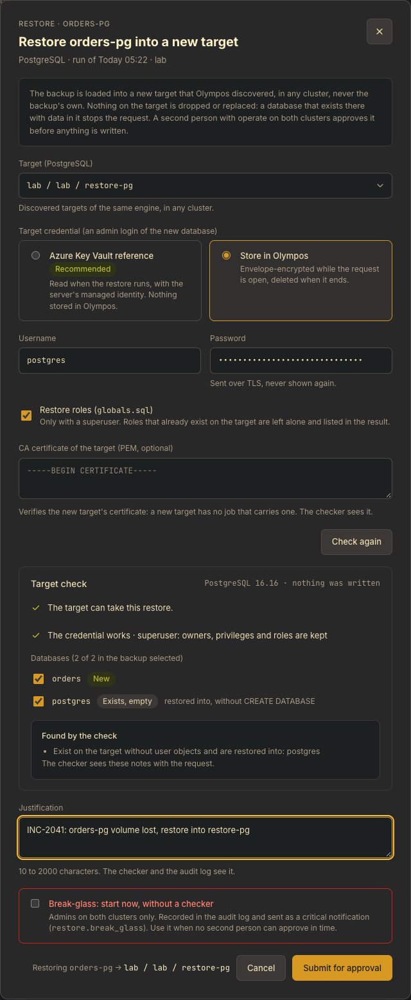

2. **Approve it.** As the approver, open **Approvals**: the restore request shows the backup, the target, the
   databases and what the check found, never the password. **Approve restore**. (The sidebar footer lists
   every role a person holds: `operator, vault-approver` for Ali now.)

   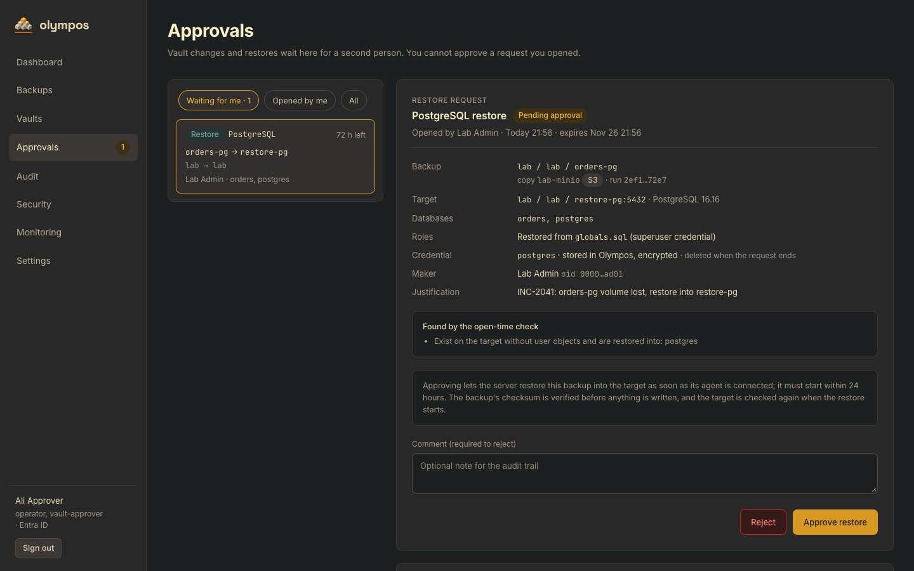

3. **Watch it run.** The server verifies the backup's SHA-256, checks the target again and restores through
   the agent tunnel. The request then shows the result per database; the credential is already deleted.

   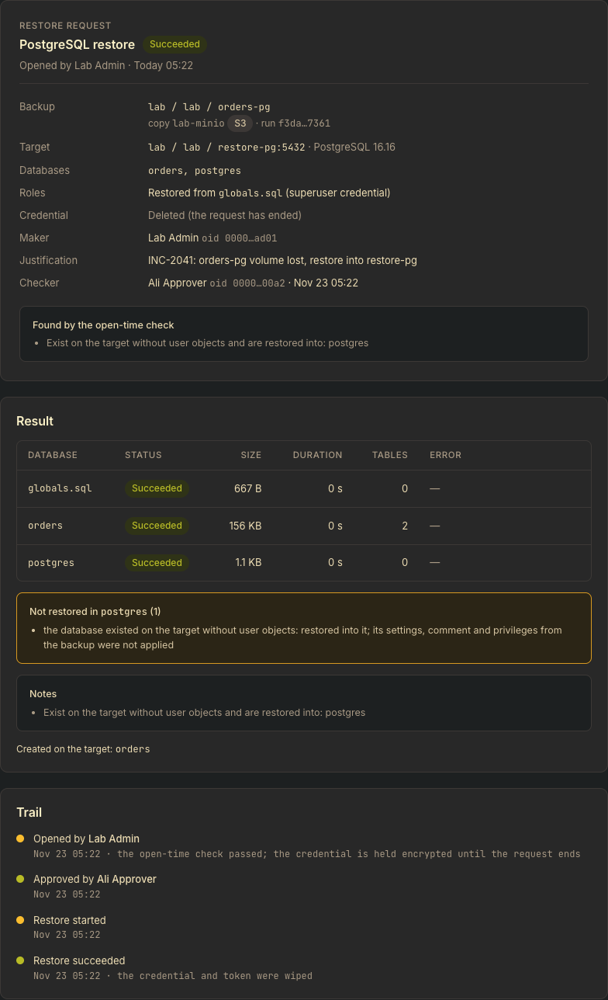

Nothing is ever overwritten: try the same restore again and the check refuses it, because `orders` now exists
on `restore-pg` with data in it. ClickHouse restores bring back databases and tables with their data and list
everything else (views, materialized views, column defaults, …) for you to re-apply; a Vault restore must be
unsealed afterwards with the **source** Vault's keys. Both are in [Restore from the UI](restore.md#restore-from-the-ui).
`./test/e2e/env.sh` empties the three servers again, but it also resets Olympos to an empty installation:
the clusters, destinations, jobs, grants and requests of steps 1–8 are gone.

## 10. Run audits

**Audit › New schedule** runs Kubescape (NSA, CIS, MITRE), Polaris or kube-bench on the clusters whose
labels match the scope. Kubescape and Polaris read the cluster through the agent's read-only API proxy;
kube-bench runs as a Job on each node of clusters where it is enabled.

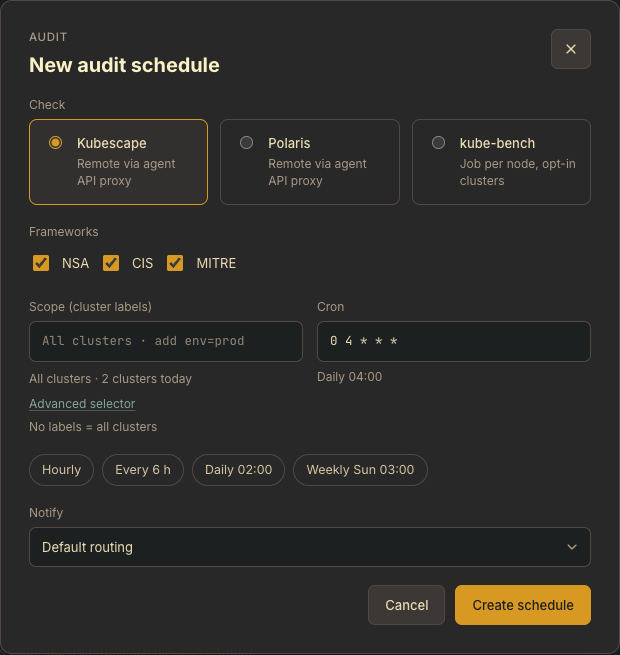

**Run now** starts a schedule right away. The Audit page shows the latest result per cluster and what
changed since the previous run:

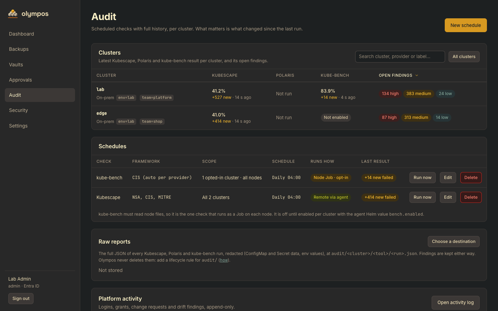

Findings are kept either way. To keep each run's full report as well (redacted: no ConfigMap or Secret data,
no literal env values), choose a destination under **Raw reports** on the same page; a global admin can set
it. Olympos never deletes these reports, so add a lifecycle rule for `audit/` on the storage.

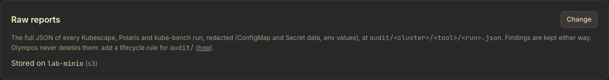

## 11. Look at security

**Security** shows, per cluster, the running images with their CVEs (scanned by digest with Trivy on the
server), Kyverno policy results, NetworkPolicy coverage and credentials found in ConfigMaps.

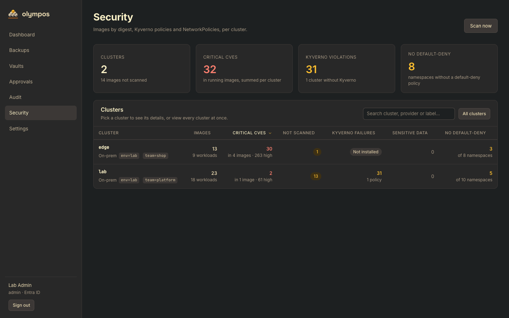

Open a cluster to see its images. Where the registry no longer has the running digest, the image with the
same tag is scanned and marked *Scanned by tag*. Private registries need a pull credential in
**Settings › Registries**.

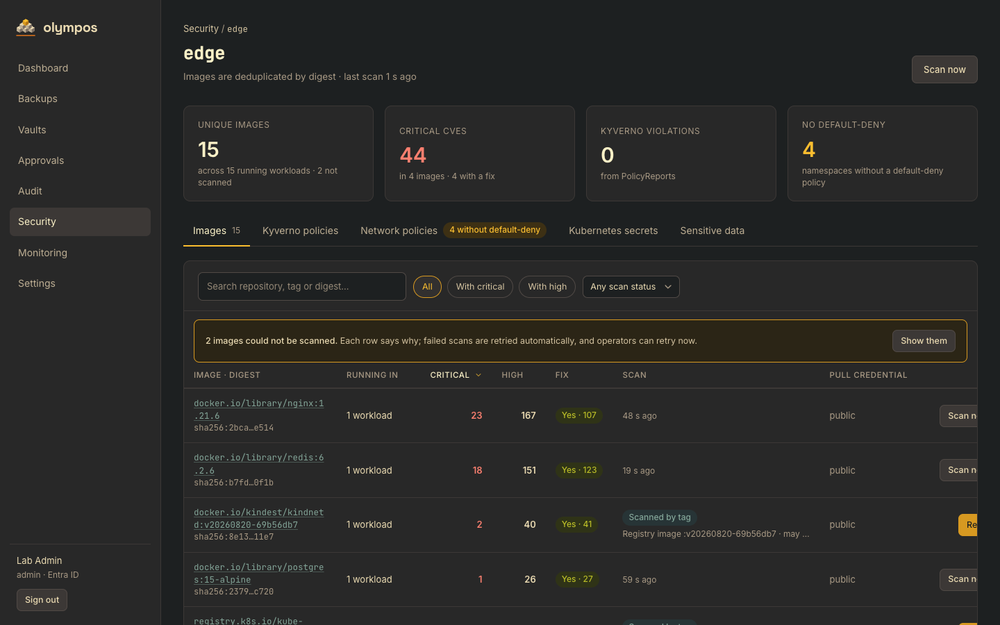

**Network policies** lists namespaces without a default-deny policy. Open a namespace to see its policies
and simulate a connection: the simulator applies Kubernetes NetworkPolicy semantics to the policies the
agent reported and explains which rule allowed or denied it.

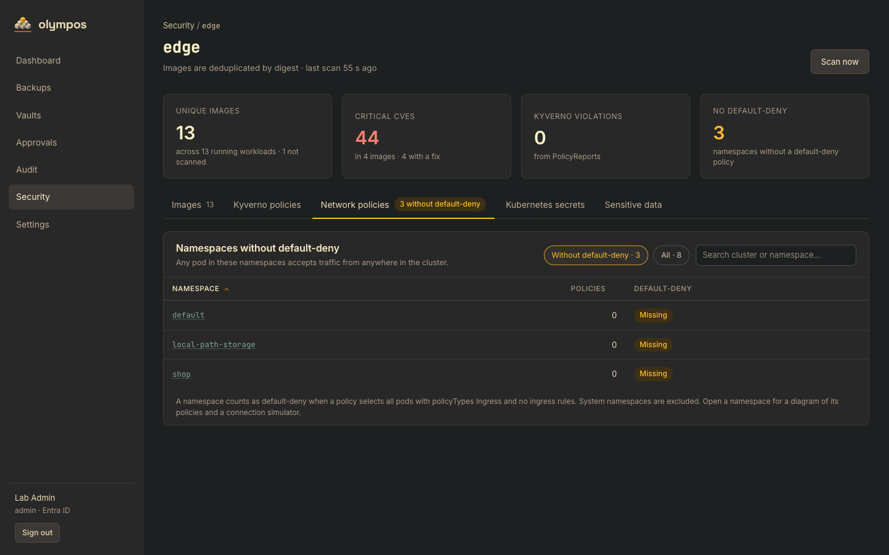

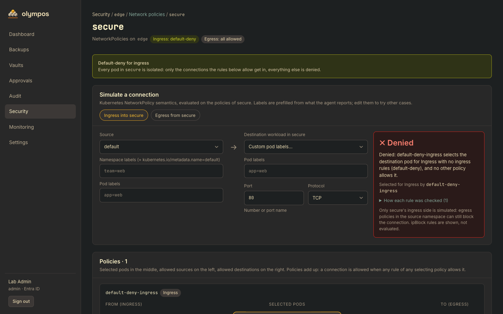

**Kyverno policies** lists policies with failing resources from the latest PolicyReports:

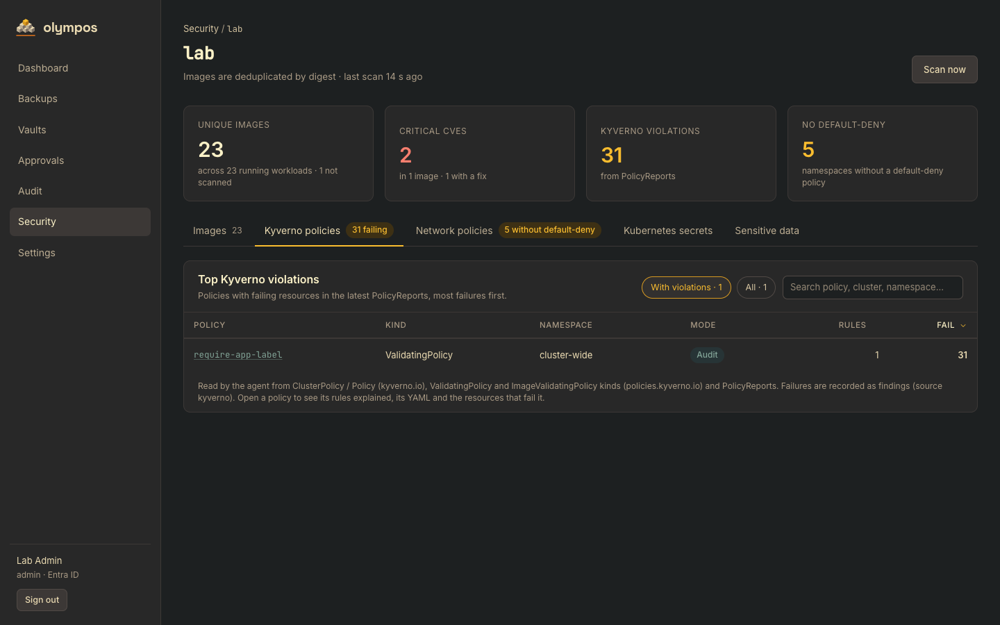

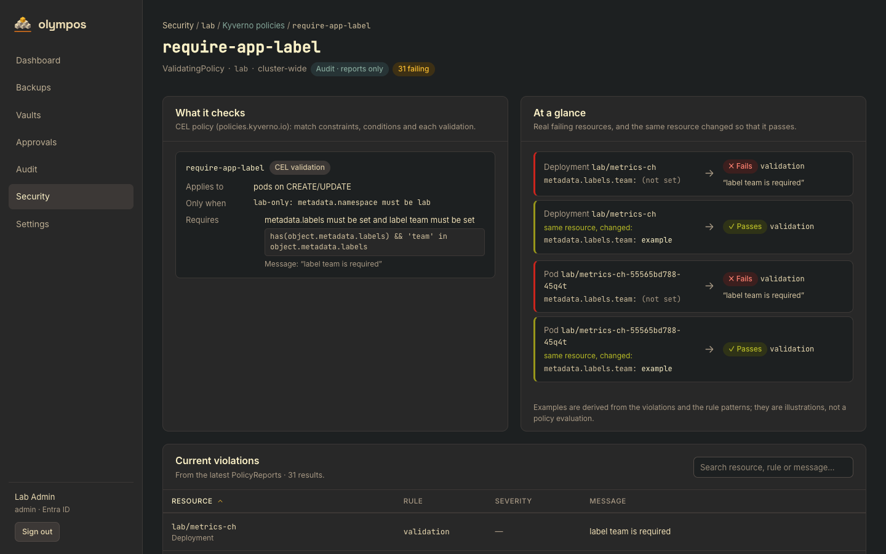

## 12. Watch a service from every cluster

**Monitoring › Synthetic** runs checks (HTTP requests and flows, DNS, TCP, TLS) from inside every cluster,
through the probe each cluster got in step 3, and alerts when one keeps failing. In the lab, every
`*.olympos-lab.test` name reaches `synth-web` in that cluster:

1. **Settings › Synthetic monitoring › Add rule**: `olympos-lab.test`, kind *suffix*. Probes may only call
   hosts on this allowlist.
2. **New credential**: *Bearer token*, bound to the suffix `olympos-lab.test`, any value.
3. **Monitoring › Synthetic › New scenario**: an HTTP flow, `GET http://shop.olympos-lab.test/health`, then
   `GET http://shop.olympos-lab.test/api/items` with the credential, *status code equals 200*; interval
   30 seconds. **Run once** tries it on one cluster; **Save scenario** runs it on both.

To see a cluster fail, switch the edge cluster's `synth-web` to answering 500; after three runs its cell
reads *failing*. `toggle ok` brings it back.

```bash
export KUBECONFIG=$PWD/test/e2e/.work/kubeconfig-env
kubectl --context kind-olympos-edge -n lab exec deploy/synth-web -- /synth-web toggle 500
```

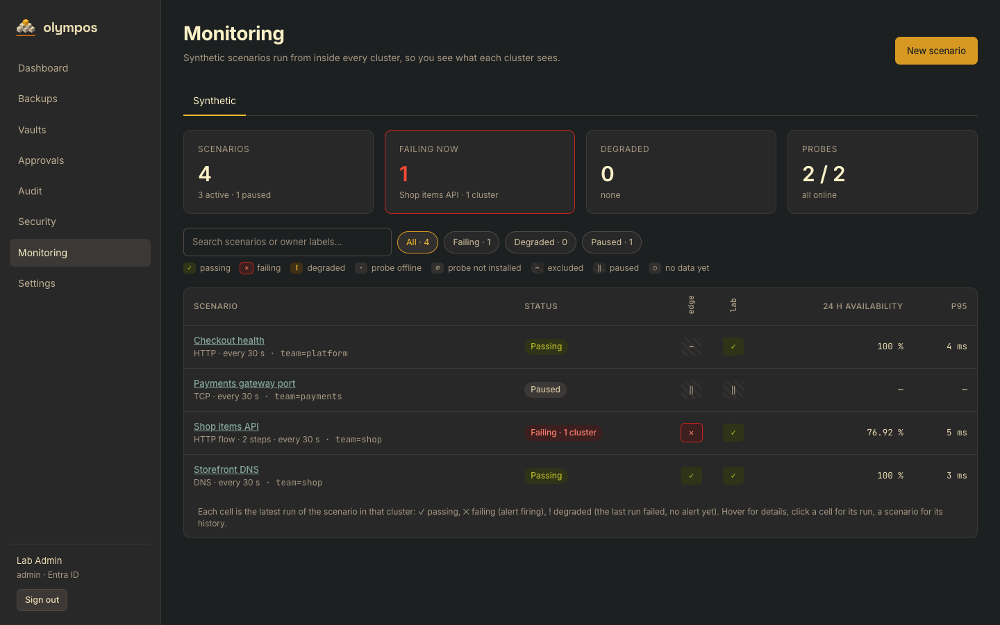

`/api/items` echoes the token and sets a cookie: open a run to see both redacted. Everything else, from the
allowlist to alerts and roles, is in [Synthetic monitoring](synthetic-monitoring.md).

## 13. Clean up

```bash
./test/e2e/env.sh down    # deletes both kind clusters
```

## Next steps

- Install for real: [Azure prerequisites](azure.md), then [on Kubernetes](install.md) or
  [on a Linux VM](install-systemd.md). Every setting is in [Configuration](configuration.md).
- Who can do what: [Access](access.md). What a finding or notification means: [Findings and events](findings-and-events.md).
- When something does not work: [Troubleshooting](troubleshooting.md).
- How Olympos protects credentials and data: [Security model](security-model.md).
- Restore a backup: [Restore](restore.md), and [Restoring Olympos](restore-olympos.md).
- Check services from every cluster: [Synthetic monitoring](synthetic-monitoring.md).
- Re-take these screenshots after a UI change: `./test/e2e/env.sh`, then `cd web && pnpm docs-tour`.
