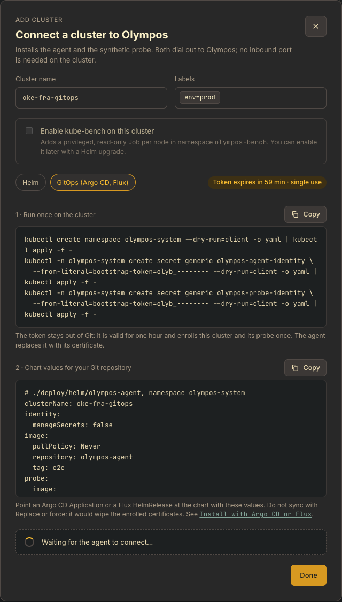

# Installing Olympos

Olympos is one installation per organization: a server (on Kubernetes, this guide, or on a
[Linux VM](install-systemd.md)) and one agent per Kubernetes cluster. Agents dial out to the server; the
server never connects into a cluster. Sign-in uses Microsoft Entra ID and keys live in Azure Key Vault; both
are required. To try Olympos first, without Azure, see [Getting started](getting-started.md).

## 1. Prerequisites

| Item | Notes |
|---|---|
| AKS (or any Kubernetes ≥ 1.27) for the server | Helm chart `deploy/helm/olympos-server` |
| PostgreSQL 16 | Azure Database for PostgreSQL Flexible Server recommended; in-cluster is fine for small installs |
| User-assigned **Managed Identity** for the server | Used for Key Vault, Blob and Microsoft Graph, via Azure Workload Identity on AKS |
| **Azure Key Vault** | Holds the KEK (RSA key), the HMAC key and every `kv://` secret |
| **Azure Blob Storage** | Backup destination, hardened as in §4 below |
| **Entra ID app registration** | Web platform, redirect URI `https://<publicURL>/auth/callback`, ID tokens |
| Network | Users → server `:443`; agents → server gateway `:8443` (mTLS). With native ClickHouse backups (§5), ClickHouse → server ingest `:9444` (HTTPS). Nothing else inbound. |

### Entra ID

1. Register an app (single tenant). Add redirect URI `https://olympos.contoso.internal/auth/callback`.
2. Create a client secret and store it in Key Vault (`olympos-oidc-client-secret`).
3. Add no API permission here: sign-in only asks for `openid profile email`. Olympos calls Microsoft Graph
   as the **server's identity** (the managed identity above, or the service principal on a VM outside
   Azure), not as this app. That identity needs the Graph app role **`User.ReadBasic.All`**, given with a
   Graph call: see [Azure prerequisites › Microsoft Graph](azure.md#microsoft-graph). It is used for the
   person search in *Settings › Access › Grant access* and the daily principal sync (disabled/deleted
   accounts → stale grants).
4. Enterprise application → Properties → **Assignment required = Yes** and assign the people who may
   sign in. This is a second gate in front of Olympos's own grants.
5. Note the tenant ID and client ID. Olympos validates `iss`, `tid`, `aud`, `exp`, `nbf` on every token
   and ignores group claims.

### Key Vault

**Soft delete and purge protection must be on.** Olympos encrypts its secrets with a KEK in Key Vault
(envelope encryption): a dump of the Olympos database (the built-in `olympos-self` backup) is useless
without that key. `deploy/bicep/keyvault.bicep` creates a vault with both enabled, the KEK and the role
assignments, but no secrets; [Azure prerequisites](azure.md) walks through it, the managed identity and
Workload Identity step by step. The server checks the KEK's recovery level at startup (needs `keys/get`, part of *Key Vault
Crypto User*) and shows "Key Vault · purge protection is off" in *Needs attention* otherwise.

```bash
az keyvault update --name kv-platform-weu --enable-purge-protection true   # existing vault
az keyvault key create --vault-name kv-platform-weu --name olympos-kek --kty RSA --size 3072 --ops wrapKey unwrapKey
az keyvault secret set --vault-name kv-platform-weu --name olympos-hmac --value "$(openssl rand -hex 32)"
# only for native ClickHouse backups (§5):
az keyvault key create --vault-name kv-platform-weu --name olympos-manifest --kty EC --curve P-256 --ops sign verify
# only for an external database (postgresql.bundled=false):
az keyvault secret set --vault-name kv-platform-weu --name olympos-db-dsn \
  --value 'postgres://olympos:<password>@<server>.postgres.database.azure.com:5432/olympos?sslmode=verify-full'
```

Grant the server identity: *Key Vault Crypto User* on the key (wrap/unwrap), *Key Vault Secrets User*
on the secrets it reads, and *Key Vault Secrets Officer* if Vault AppRole secret IDs should be stored
there (Vaults › Configure writes `olympos-vault-<id>-secret-id`). For native ClickHouse backups, also *Key
Vault Crypto User* on `olympos-manifest` ([The manifest key](#the-manifest-key)); the Bicep template does both.

## 2. Server

```yaml
# values.yaml
workloadIdentity: {enabled: true, clientID: <managed identity client id>}
olympos:
  publicURL: https://olympos.contoso.internal
  agentGatewayURL: olympos-gw.contoso.internal:8443
  entra:
    tenantID: <tenant guid>
    clientID: <app client id>
    clientSecretRef: kv://kv-platform-weu/olympos-oidc-client-secret
  bootstrapAdmins: [<object id of the first admin>]   # used only while no grants exist
  keyVault:
    name: kv-platform-weu
    kekName: olympos-kek
    hmacSecretName: olympos-hmac
    # Who besides global admins may enter kv:// references (backup credentials), and for which
    # clusters. Without rules only global admins can. Olympos' own secrets are never referenceable.
    # references:
    #   - {ref: "kv-platform-weu/dev-*", scope: "env=dev"}
    #   - {ref: "kv-platform-weu/prod-*", scope: "env=prod"}
    # managedIdentityClientID: leave empty with Workload Identity (it would bypass it; see azure.md)
  # database: by default the chart runs a bundled PostgreSQL 16 in the same namespace
  # (postgresql.bundled=true). For an external one: postgresql.bundled=false and
  #   database: {dsnRef: kv://kv-platform-weu/olympos-db-dsn}
  slack:
    botTokenRef: kv://kv-platform-weu/olympos-slack-bot-token   # chat:write
  deadMansSwitch:
    url: https://heartbeat.example/olympos                       # strongly recommended
  targetTLS:
    caBundleFile: /etc/olympos/target-ca/ca.crt                  # CAs that issue your targets' certificates
    # systemRoots: false   # public CAs are not trusted for targets unless set (see below)
ingress: {enabled: true, className: nginx, host: olympos.contoso.internal, tlsSecretName: olympos-tls}
```

```bash
helm upgrade --install olympos deploy/helm/olympos-server -n olympos --create-namespace -f values.yaml
```

The gateway (`:8443`) is exposed by an internal LoadBalancer by default. Its TLS certificate is
issued by Olympos's internal CA for the host of `agentGatewayURL` (agents pin that CA); set
`gatewayTLSSecret` to use your own. **Do not terminate TLS for `:8443` in a proxy** — mTLS must reach
the server.

The server image is about 1.8 GB (it was about 0.8 GB) because it carries the static ClickHouse client used for ClickHouse restores; plan registry and node disk accordingly.

### Target certificates

The server verifies every target's certificate end to end against `targetTLS.caBundleFile` (and a
per-target CA where one is set). **Public CAs are not trusted for targets by default**: the name a
target is verified against comes from its Service (`olympos.io/tls-server-name`), and anyone who can
edit that Service could otherwise point it at a pod with a public certificate for a domain they own.
Set `targetTLS.systemRoots: true` only if your targets really use publicly issued certificates.

The TLS name is pinned when Olympos first sees a target. If the annotation changes later, backups and
Vault calls keep verifying the pinned name, *Needs attention* shows "TLS name changed", and an admin of
that cluster accepts the new name under *Backups* (or reverts the annotation).

### Olympos' own database

By default the chart deploys a single-instance PostgreSQL 16 next to the server (`postgresql.bundled:
true`): the official `postgres` image pinned by digest, a PVC (`postgresql.size`, default 8 Gi), a
NetworkPolicy that admits only the server pods, and a generated password in the Secret
`<release>-postgresql` (kept on upgrade and uninstall). Host connections use SCRAM-SHA-256. For an
external database (Azure Database for PostgreSQL) set `postgresql.bundled: false` and
`olympos.database.dsnRef`. The schema needs the `pgcrypto` extension: on Azure Database for PostgreSQL
allow it first (`az postgres flexible-server parameter set -g <rg> -s <server> --name azure.extensions
--value PGCRYPTO`); elsewhere install the PostgreSQL contrib package.

Its state (grants, the internal CA key, change requests, schedules) must survive a lost cluster: after
installing, open **Backups › Olympos database** and choose a destination, or a destination group to keep
two independent copies ([Getting started](getting-started.md#6-write-each-backup-to-two-destinations)).
The built-in job `olympos-self` (`pg_dump -Fc`, daily by default, same manifest, tags and retention as
every job) cannot be deleted; the Dashboard shows *Needs attention* until it has a destination. Restore:
`docs/restore-olympos.md`.

**v0.1 runs as a single replica.** Availability comes from Kubernetes restarting the pod; agents reconnect
automatically. Multi-replica is planned for v0.2 ([#21](https://github.com/Warewave-Technology/olympos/issues/21)). A tunnel can only be opened on the replica the agent is
connected to, so more replicas would work only sometimes: the chart refuses `replicas > 1` and uses the
`Recreate` strategy. Every server instance registers in the database; if a second live instance appears
(two hosts pointed at the same database, a stuck old pod), the newer one logs an error and reports
`/readyz` not ready until the older one is gone. `experimental.multiReplica: true` lifts both checks and
is unsupported.

## Restricted networks

Olympos works without internet egress from the server:

- **kubescape**: the frameworks, controls, exceptions and control inputs are downloaded when the image and
  the packages are built (`/usr/share/olympos/kubescape-artifacts`) and scans run with
  `--use-artifacts-from`, so no call to the ARMO API is made. They are as recent as the Olympos release; to
  refresh them in between, run `kubescape download artifacts --output <dir>` on a connected host, copy the
  directory in (a volume in Helm, any path for systemd) and set `audit.kubescapeArtifacts: <dir>`.
- **trivy**: the vulnerability DB is pulled from an OCI registry; mirror `ghcr.io/aquasecurity/trivy-db`
  (and `trivy-java-db`) into your registry and set `security.trivyDBRepo: <your-registry>/trivy-db`. The
  server updates the DB at most once an hour and keeps scanning with the last one while the mirror is
  unreachable.
- **Images and charts**: mirror `ghcr.io/warewave-technology/*` and use `OLYMPOS_AGENT_INSTALL_SETS` to make
  the generated agent install command point at the mirror, for the agent and the probe
  (`image.repository=…,probe.image.repository=…`).
- **Entra ID, Key Vault, backup storage** need private endpoints (see §1 and §4).

## Verifying releases

Every release (tag `v*`) is built by `.github/workflows/release.yml` and signed keyless with cosign through
GitHub's OIDC identity: images (`olympos-server`, `olympos-agent` and, from v0.3.0, `olympos-probe`),
binaries, tarballs, `.deb`/`.rpm` and both Helm charts. Each artifact has an
SBOM (SPDX and CycloneDX) and SLSA provenance. Signatures and GitHub attestations are made only while the
repository is public (keyless signing writes to the public Rekor log); a release from the private repository
carries the SBOMs and `SHA256SUMS-<arch>` only. Verify before installing (`v0.1.0` as an example):

```bash
ID='^https://github.com/Warewave-Technology/olympos/.github/workflows/release.yml@refs/tags/v'
ISSUER=https://token.actions.githubusercontent.com

# Images (signature, SBOM attestation)
cosign verify ghcr.io/warewave-technology/olympos-server:0.1.0 --certificate-identity-regexp "$ID" --certificate-oidc-issuer "$ISSUER"
cosign verify-attestation --type spdxjson ghcr.io/warewave-technology/olympos-server:0.1.0 \
  --certificate-identity-regexp "$ID" --certificate-oidc-issuer "$ISSUER" >/dev/null && echo sbom ok
# The same for olympos-agent, and for olympos-probe (synthetic monitoring, v0.3.0 and later)
cosign verify ghcr.io/warewave-technology/olympos-probe:0.3.0 --certificate-identity-regexp "$ID" --certificate-oidc-issuer "$ISSUER"
cosign verify-attestation --type spdxjson ghcr.io/warewave-technology/olympos-probe:0.3.0 \
  --certificate-identity-regexp "$ID" --certificate-oidc-issuer "$ISSUER" >/dev/null && echo sbom ok

# Helm charts (OCI)
cosign verify ghcr.io/warewave-technology/charts/olympos-server:0.1.0 --certificate-identity-regexp "$ID" --certificate-oidc-issuer "$ISSUER"
helm install olympos oci://ghcr.io/warewave-technology/charts/olympos-server --version 0.1.0 -n olympos --create-namespace -f values.yaml

# Packages and tarballs (bundle next to each file)
cosign verify-blob olympos-server_0.1.0-1_amd64.deb --bundle olympos-server_0.1.0-1_amd64.deb.sigstore.json \
  --certificate-identity-regexp "$ID" --certificate-oidc-issuer "$ISSUER"

# Checksum of exactly the file you downloaded (same for the .rpm and the tarball)
f=olympos-server_0.1.0-1_amd64.deb   # olympos-server-0.1.0-1.x86_64.rpm, olympos-server_0.1.0_linux_amd64.tar.gz
grep " $f\$" SHA256SUMS-amd64 > check.sha256 && sha256sum -c --strict check.sha256

# Build provenance (GitHub attestation)
gh attestation verify olympos-server_0.1.0-1_amd64.deb --repo Warewave-Technology/olympos
```

The checksum step must print `<file>: OK`. Anything else, or no output at all, means the file was not verified:
do not install it. Checking the whole `SHA256SUMS` file while skipping missing files is not enough: that
succeeds when none of the listed files is present (with a renamed download, for example). On macOS,
`sha256sum` (macOS 14+) works the same way.

Pin images by digest in production (`image.digest` in the chart values, and `probe.image.digest` for the
probe in the agent chart).

### The kube-bench image

kube-bench (opt-in per cluster, `bench.enabled`) runs `docker.io/aquasec/kube-bench`, pinned by digest in the
agent binary: an agent only ever starts that exact image. The kube-bench project does not sign its images, so
there is no upstream signature to check. Instead, each Olympos release copies the pinned index, byte for byte,
to `ghcr.io/warewave-technology/kube-bench` and signs it with the release identity above. The signature says
that an Olympos release pinned this digest; it does not come from the kube-bench project.

```bash
# The digest the agent pins (also printed by scripts/kube-bench-pin.sh print)
D=sha256:75506f222d1eb6ce2a751a5533bdc0a3b54c898e2e49e7751d0ee22cfb862679
cosign verify ghcr.io/warewave-technology/kube-bench@$D --certificate-identity-regexp "$ID" --certificate-oidc-issuer "$ISSUER"
```

To pull from the mirror instead of Docker Hub, install the agent with
`--set bench.imageRepository=ghcr.io/warewave-technology/kube-bench`. For a registry you run, copy the image
with its signature and point the agent at it; the digest stays the pinned one whatever the repository:

```bash
cosign copy ghcr.io/warewave-technology/kube-bench@$D registry.example.com/mirror/kube-bench:v0.16.0
helm upgrade olympos-agent … --reuse-values --set bench.imageRepository=registry.example.com/mirror/kube-bench
```

Clusters that enforce image signatures with Kyverno (1.17 or later) can apply
[deploy/kyverno/kube-bench-signature.yaml](../deploy/kyverno/kube-bench-signature.yaml): it admits pods in
`olympos-bench` only with an image signed by an Olympos release (adjust its `glob` for your own mirror).

## 3. Agents

In the UI: **Dashboard › Add cluster** → name, labels, kube-bench opt-in → copy the generated Helm
command (it contains a one-time bootstrap token valid for 1 h and the server CA) and run it against the
cluster. The cluster turns *online* within seconds. Show the command again from *Settings › Clusters & agents* (*Show install command*)
if the token expired.

For on-prem clusters set `--set providerOverride=onprem` (or change it later in *Settings › Clusters & agents*).

The agent chart also installs `olympos-probe`, which runs synthetic monitoring scenarios from inside the
cluster. It dials out to the same gateway, has a ServiceAccount with no RBAC and no token, and its identity
is kept by the agent in the Secret `olympos-probe-identity`; the install command enrolls both. Opt out with
`--set probe.enabled=false`. On a cluster added before the probe existed, `helm upgrade` adds the probe, and
it waits ("Probe: not installed") until you run the command from *Settings › Clusters & agents › Install
probe*. `probe.networkPolicy.egressCIDRs` restricts its egress at the network level too (see
[configuration.md](configuration.md#agent-helm-values-deployhelmolympos-agent)).

Annotate Services to be discovered (`olympos.io/backup`, `olympos.io/vault`, `olympos.io/port`,
`olympos.io/tls-server-name`, see SPEC §5).

### Install with Argo CD or Flux

Argo CD, and any pipeline that renders the charts with `helm template` (a Flux `Kustomization` of rendered
manifests, for one), cannot use Helm's `lookup`: it finds nothing there, so two Secrets the charts keep with `lookup` would be rewritten on every sync: the bootstrap token
would be written again into the agent's identity Secrets (the probe then retries a spent token on every
sync, and the application never shows in sync), and the server chart would generate a new database
password (the server then loses its database). Two values keep these Secrets out of the rendered output:

- **Agent chart: `identity.manageSecrets: false`.** The chart renders neither `olympos-agent-identity` nor
  `olympos-probe-identity`. Create them once on the cluster instead, with the bootstrap token, before the
  application syncs. *Add cluster* and *Install probe* show the commands under **GitOps (Argo CD, Flux)**,
  with the chart values for Git next to them. The token never goes into Git: it is valid for one hour and
  used once, and the agent replaces it with its certificate.

  ```bash
  kubectl create namespace olympos-system --dry-run=client -o yaml | kubectl apply -f -
  kubectl -n olympos-system create secret generic olympos-agent-identity \
    --from-literal=bootstrap-token=<token> --dry-run=client -o yaml | kubectl apply -f -
  kubectl -n olympos-system create secret generic olympos-probe-identity \
    --from-literal=bootstrap-token=<token> --dry-run=client -o yaml | kubectl apply -f -
  ```

  `kubectl apply` adds the token to a Secret that exists and keeps its other keys, so the same command
  installs a probe again on a cluster whose probe was revoked.

  
- **Server chart: `postgresql.existingSecret`.** Create a Secret with a `password` key once, name it here,
  and the chart renders no password. A Secret from Git (SealedSecrets, External Secrets) is fine here: the
  password is meant to last.

  ```bash
  kubectl -n olympos create secret generic olympos-db --from-literal=password="$(openssl rand -base64 30)"
  ```

Never sync these Secrets with `Replace=true` (Argo CD) or `force: true` (Flux): a replace drops the keys
the agent wrote, and the agent and the probe lose their certificates. Plain `apply` (client-side or
server-side) keeps them.

An Argo CD `Application` for the agent:

```yaml
apiVersion: argoproj.io/v1alpha1
kind: Application
metadata: {name: olympos-agent, namespace: argocd}
spec:
  project: default
  destination: {server: https://kubernetes.default.svc, namespace: olympos-system}
  source:
    repoURL: ghcr.io/warewave-technology/charts   # registered in Argo CD as an OCI Helm repository
    chart: olympos-agent
    targetRevision: 0.4.0
    helm:
      valuesObject:            # the values from the GitOps tab of Add cluster
        server: olympos-gw.contoso.internal:8443
        clusterName: oke-fra-mes
        serverCA: LS0tLS1CRUdJTi…
        identity: {manageSecrets: false}
  syncPolicy:
    automated: {selfHeal: true}
    syncOptions: [ServerSideApply=true]
```

A Flux `HelmRelease` for the agent (with an `OCIRepository` named `olympos-agent` that points at
`oci://ghcr.io/warewave-technology/charts/olympos-agent`):

```yaml
apiVersion: helm.toolkit.fluxcd.io/v2
kind: HelmRelease
metadata: {name: olympos-agent, namespace: olympos-system}
spec:
  interval: 10m
  chartRef: {kind: OCIRepository, name: olympos-agent}
  values:                      # the values from the GitOps tab of Add cluster
    server: olympos-gw.contoso.internal:8443
    clusterName: oke-fra-mes
    serverCA: LS0tLS1CRUdJTi…
    identity: {manageSecrets: false}
```

A Flux `HelmRelease` installs with Helm itself, where `lookup` works, so plain values work there too. With
`driftDetection` on, use the two values above: the agent changes its identity Secrets after the install,
which drift detection reports and corrects as drift. The server chart takes `postgresql.existingSecret: olympos-db` the same way.

## 4. Backup storage hardening (required)

Use `deploy/bicep/backup-storage.bicep`, or apply the same settings by hand:

1. Public network access **disabled**; access only through a **Private Endpoint** in the server VNet.
2. Managed Identity option: `allowSharedKeyAccess = false`.
3. Data-plane RBAC only for the server MI, custom role with `blobs/read`, `blobs/write`,
   `blobs/add/action`, `blobs/tags/read`, `blobs/tags/write` — **no `blobs/delete`**. No human data-plane
   roles; break-glass through a PIM time-bound assignment.
4. Blob **versioning + soft delete + version-level immutability** ≥ the longest retention tier.
5. Resource lock `CanNotDelete` on the account.
6. Azure Policy: deny public network access and shared-key re-enablement.
7. Diagnostic logs to Log Analytics; alert on any data-plane operation by a principal other than the
   server MI.

**Retention is done by lifecycle rules, not by Olympos.** Every backup blob carries the index tag
`olympos-tier=daily|weekly|monthly` (GFS decided at write time) and dry runs carry `olympos-tier=test`.
The Bicep module renders one lifecycle rule per tier. The server has no delete permission and no
delete code path; *Settings › Destinations › Test destination* warns if the credential can delete.

**Weekly retention must be at least daily retention plus 7 days, plus the job's retry window**, for native
ClickHouse jobs with incrementals. A chain of native backups (a full and the daily incrementals on it) spans at
most one week, and the server re-tags the chain's daily runs `weekly` when it takes an incremental on them, so
a week's incrementals are kept as long as the weekly tier ([configuration.md](configuration.md#ingest),
*Retention of incrementals*). The week is counted by the runs' scheduled times, and lifecycle rules count from
when an object was written: a run retried after an agent disconnect keeps its scheduled time and can be written
up to the retry window later (half the time to the job's next scheduled run, 12 hours for a daily job). The
first run of a month is a full, so monthly backups never depend on a chain. The same holds for the S3 and NFS
rules below; the Bicep module's defaults (7 and 28 days) meet it.

**Objects of runs that did not finish.** A native ClickHouse backup writes its objects with the tag
`olympos-state=incomplete` and retags them `olympos-state=complete` only after the run's signed manifest is
written, the manifest itself last; every object also carries its `olympos-tier`. A run that dies (a server
restart, a lost network, a stopped ClickHouse) leaves incomplete objects behind, and Olympos does not delete
them. The Bicep module renders the rule `olympos-incomplete`, which deletes objects tagged
`olympos-state=incomplete` 7 days after creation (parameter `incompleteDays`); for S3 and NFS see
[S3 and S3-compatible storage](#s3-and-s3-compatible-storage) and [NFS](#nfs). A backup that completed is not
affected: the retag replaces the tag, so the rule's filter no longer matches its objects. A server that shuts
down does not cut a retag under way: it goes on for up to 30 minutes, or until the process is killed (on
Kubernetes, at the end of the pod's termination grace period). A retag cut that way leaves some objects
tagged `complete` under a manifest still tagged `incomplete`. The `incomplete` rule then removes the
manifest and the objects still incomplete, and the run is failed; the objects already tagged `complete` are
removed by their tier's rule (for example `olympos-daily`), not after 7 days.

> **Time-based immutability defers the delete.** An object under a time-based immutability policy (the
> container policy of the Bicep module, S3 Object Lock, WORM on an NFS share) cannot be deleted before its
> period ends, so an incomplete object is kept until then, not for 7 days. With the Bicep module's container
> policy that is the longest retention tier (400 days), for every tier rule alike; this is tracked in
> [#79](https://github.com/Warewave-Technology/olympos/issues/79).

### SAS token option

If Managed Identity is not possible, paste a **container-scoped SAS** with permissions `r c w t` only
(no `d`, no `l`). Olympos parses `se` and raises `sas.expiring` 14 and 3 days before expiry; runs fail
fast after expiry. Account/service SAS requires shared-key access on the account.

### Azure endpoint override

`endpoint_override` (Settings › Destinations, or the API) replaces
`https://<account>.blob.core.windows.net` — for sovereign clouds, private DNS names or Azurite
(`http://azurite.olympos.svc:10000/devstoreaccount1`). The scheme decides TLS.

### S3 and S3-compatible storage

Kind **s3** writes to an AWS S3 bucket, or to any S3-compatible service (MinIO, Ceph RGW, NetApp
StorageGRID, Wasabi, …) through `endpoint_override` (`https://minio.example.internal:9000`; the scheme
decides TLS; empty = `https://s3.<region>.amazonaws.com`, region default `us-east-1`). Most
S3-compatible services need **path-style** addressing; AWS uses virtual-hosted style. Auth is a static
access key: the access key ID is shown in the UI, the secret key is stored envelope-encrypted or as a
`kv://` reference and is read at use time. Private CAs: set `olympos.backup.storageCABundleFile` (PEM,
added to the system roots; independent of `targetTLS`).

```yaml
olympos:
  backup:
    storageCABundleFile: /etc/olympos/storage-ca/ca.crt   # optional
    s3PartSizeMiB: 32        # multipart part size; memory per running upload; max object = 10 000 parts
```

Uploads stream (no temp file) as multipart uploads, compute sha256 on the fly, set the object tag
`olympos-tier` with the upload and never overwrite an existing key (HEAD before every upload; objects
up to 8 MiB additionally use `If-None-Match: *`).

**Policy — no `s3:DeleteObject`.** Give the Olympos user exactly this (AWS IAM policy; MinIO and Ceph
accept the same document):

```json
{
  "Version": "2012-10-17",
  "Statement": [
    {"Effect": "Allow", "Action": ["s3:ListBucket", "s3:GetBucketLocation", "s3:ListBucketMultipartUploads"],
     "Resource": "arn:aws:s3:::olympos-backups"},
    {"Effect": "Allow",
     "Action": ["s3:PutObject", "s3:GetObject", "s3:PutObjectTagging", "s3:GetObjectTagging",
                "s3:AbortMultipartUpload", "s3:ListMultipartUploadParts"],
     "Resource": "arn:aws:s3:::olympos-backups/*"}
  ]
}
```

`s3:ListBucket` is needed so that a missing key answers 404 (the existence check before each upload)
and for the bucket check of *Test destination*. On AWS, add a bucket policy statement that denies
deletes to everyone but a break-glass role:

```json
{"Effect": "Deny", "Principal": "*",
 "Action": ["s3:DeleteObject", "s3:DeleteObjectVersion", "s3:PutLifecycleConfiguration", "s3:PutBucketObjectLockConfiguration"],
 "Resource": ["arn:aws:s3:::olympos-backups", "arn:aws:s3:::olympos-backups/*"],
 "Condition": {"ArnNotLike": {"aws:PrincipalArn": "arn:aws:iam::<account>:role/backup-break-glass"}}}
```

*Test destination* checks the endpoint (reachable, TLS verified, bucket exists), writes/reads/tags a
probe under `{prefix}/.olympos-probe/` and expects the delete of the probe to be refused
(`AccessDenied`); if the delete succeeds the destination is saved with a **can delete** warning.

**Object Lock.** Create the bucket with Object Lock enabled (implies versioning) and a default retention
in **compliance** mode ≥ the longest tier, e.g.
`aws s3api put-object-lock-configuration --bucket olympos-backups --object-lock-configuration '{"ObjectLockEnabled":"Enabled","Rule":{"DefaultRetention":{"Mode":"COMPLIANCE","Days":400}}}'`
(MinIO: `mc retention set --default compliance 400d <alias>/olympos-backups`). Compliance mode cannot be
shortened or removed, not even by the root user.

**Retention = lifecycle rules filtered by the `olympos-tier` tag** (Olympos never deletes):

```json
{"Rules": [
  {"ID": "daily",   "Status": "Enabled", "Filter": {"Tag": {"Key": "olympos-tier", "Value": "daily"}},   "Expiration": {"Days": 8},   "NoncurrentVersionExpiration": {"NoncurrentDays": 1}},
  {"ID": "weekly",  "Status": "Enabled", "Filter": {"Tag": {"Key": "olympos-tier", "Value": "weekly"}},  "Expiration": {"Days": 29},  "NoncurrentVersionExpiration": {"NoncurrentDays": 1}},
  {"ID": "monthly", "Status": "Enabled", "Filter": {"Tag": {"Key": "olympos-tier", "Value": "monthly"}}, "Expiration": {"Days": 366}, "NoncurrentVersionExpiration": {"NoncurrentDays": 1}},
  {"ID": "test",    "Status": "Enabled", "Filter": {"Tag": {"Key": "olympos-tier", "Value": "test"}},    "Expiration": {"Days": 7},   "NoncurrentVersionExpiration": {"NoncurrentDays": 1}},
  {"ID": "audit",   "Status": "Enabled", "Filter": {"Tag": {"Key": "olympos-tier", "Value": "audit"}},   "Expiration": {"Days": 400}, "NoncurrentVersionExpiration": {"NoncurrentDays": 1}},
  {"ID": "incomplete", "Status": "Enabled", "Filter": {"Tag": {"Key": "olympos-state", "Value": "incomplete"}}, "Expiration": {"Days": 7}, "NoncurrentVersionExpiration": {"NoncurrentDays": 1}},
  {"ID": "probe",   "Status": "Enabled", "Filter": {"Prefix": "olympos/.olympos-probe/"},                 "Expiration": {"Days": 1}},
  {"ID": "mpu",     "Status": "Enabled", "Filter": {}, "AbortIncompleteMultipartUpload": {"DaysAfterInitiation": 2}}
]}
```

Apply with `aws s3api put-bucket-lifecycle-configuration --bucket olympos-backups --lifecycle-configuration file://lifecycle.json`
(MinIO: `mc ilm import`). Choose `Days` from the job retention (`daily: 7` → 8 days, …), with the weekly
`Days` at least the daily ones plus 8 for native incrementals of a daily job (7 days and the retry window, see
above), and adjust the probe prefix to your destination
prefix. With Object Lock, an expiration only adds a delete marker
until the lock period of the version has ended.

The `incomplete` rule removes what a native ClickHouse backup left behind when its run died: the run writes
every object with `olympos-state=incomplete` and replaces the tag with `olympos-state=complete` after the
run's manifest is signed, so only unfinished objects match. It uses `Days: 7`, not `8`: a run is over long
before then. The `mpu` rule above is separate: it aborts multipart uploads that were never completed, which
are not objects yet and carry no tags. With Object Lock, the expiration only adds a delete marker until the
lock period of the version has ended
([#79](https://github.com/Warewave-Technology/olympos/issues/79) covers the same effect on Azure).

### NFS

Kind **nfs** writes files below a volume mounted into the server. Volumes live under
`olympos.backup.nfsRoot` (default `/var/lib/olympos/nfs`); **every first-level subdirectory is one
mount** (the Helm value `nfsMounts: [{name, <volume source>}]` mounts each at
`/var/lib/olympos/nfs/<name>`; hidden names and symlinks are ignored). *Settings › Destinations* lists
them (`GET /destinations/mounts`, with a writable check). A destination `path` must resolve — after
cleaning and symlink evaluation — inside a mount, e.g. `/var/lib/olympos/nfs/backup-nas/olympos`; `..`
is rejected. The pod runs as uid/gid 65532 with fsGroup 65532: export the share so that this user can
write (e.g. `all_squash,anonuid=65532,anongid=65532`, or a directory owned by 65532).

```yaml
olympos:
  backup:
    nfsRoot: /var/lib/olympos/nfs   # default
```

Each file is written as `<file>.partial` (0640, created exclusively) → fsync → hard-linked to its
final name (never replaces an existing file; filesystems without hard links fall back to check +
rename) → `.partial` removed; directories are 0750. Tags are stored next to each file in
`<file>.tags.json` (`{"olympos-tier":"daily"}`) and the tier is also in the manifest.

**Retention is the storage's job.** Olympos never deletes backups, but on a filesystem it technically
*can* (the server user owns the files), so *Test destination* reports **can delete** with a warning.
Protect backups on the storage side with read-only **snapshots** on their own schedule or **WORM**
(NetApp SnapLock, PowerScale SmartLock, ZFS snapshots with holds), and expire files by tier with a
storage-side job that reads the `.tags.json` sidecars. For native ClickHouse runs only the sidecars decide
retention, not the `Tier` in the run's manifest: an incremental re-tags the runs of its chain (a daily run to
weekly) in their sidecars, while the manifest keeps the tier the run was written with, so a job that follows
the manifests would delete a chain's runs before the incrementals that need them.

**Cleaning up incomplete runs.** A native ClickHouse backup writes each file, then its sidecar
`<file>.tags.json` with `{"olympos-state":"incomplete","olympos-tier":"daily"}`, and rewrites the sidecars
with `"olympos-state":"complete"` once the run's manifest is signed (the manifest's own sidecar last). A run
that died can leave four kinds of files behind, and each has its own check below. Run them as the storage
administrator, on the NFS server or on any host that mounts the share with write access (the Olympos server
keeps its no-delete permissions). Every check lists first; delete only what the list shows you expect. The
age is `-mtime +7`, files last changed at least 8 days ago, far longer than a run lasts.

Run all the blocks below in one shell session, in order: they share the directory and the list file `$list`
that this first block sets.

```sh
cd /srv/backup-nas/olympos &&     # the destination path, on the share
list=$(mktemp)                    # private list files, not a fixed name in /tmp
```

1. **Files whose sidecar says `incomplete`.** A died run, or a run that failed while writing the sidecars.
   Dry run:

   ```sh
   find . -name '*.tags.json' -mtime +7 -exec grep -q '"olympos-state":"incomplete"' {} \; -print0 > "$list"
   tr '\0' '\n' < "$list"
   ```

   Each entry is a sidecar. Delete each file first and its sidecar second, so that an interrupted
   delete never leaves a file without the sidecar that finds it again (`-r` is GNU xargs; on BSD and macOS
   leave it out, `xargs` already does nothing for an empty list):

   ```sh
   xargs -0 -r -n1 sh -c 'rm -v -f -- "${1%.tags.json}" && rm -v -- "$1"' _ < "$list"
   ```

2. **`*.partial` files.** A write that was killed leaves `<file>.partial`, and a killed retag leaves
   `<file>.tags.json.<id>.partial`. Olympos never publishes a name ending in `.partial`, so none of them is a
   backup; one that is 8 days old belongs to no upload that is still running.

   ```sh
   find . -name '*.partial' -mtime +7 -print0 > "$list"
   tr '\0' '\n' < "$list"
   xargs -0 -r rm -v -- < "$list"      # after you have read the list
   ```

3. **Files with no sidecar.** If the process died after a file was written and before its sidecar, or the
   sidecar write failed, the file stays with no tag at all, and check 1 cannot find it. This list is for
   **review only**: a file without a sidecar is also what a backup made by another tool or by an older
   Olympos looks like. It lists only files inside a run directory (a directory named by the run's UUID) whose
   run is not complete, that is, whose manifest sidecar `<run-id>.manifest.json.tags.json` does not say
   `complete`. Every object of a completed run has a sidecar, and a completed run is skipped as a whole.

   ```sh
   find . -type d -name '????????-????-????-????-????????????' | while IFS= read -r d; do
     grep -q '"olympos-state":"complete"' "$d.manifest.json.tags.json" 2>/dev/null && continue
     find "$d" -type f ! -name '*.tags.json' ! -name '*.partial' -mtime +7 | while IFS= read -r f; do
       [ -e "$f.tags.json" ] || printf '%s\n' "$f"
     done
   done
   ```

   Check that each listed run really has no manifest or an incomplete one, then remove its files with
   `rm`. Do not automate this check.

4. **Empty directories** of removed runs stay. `find . -mindepth 1 -type d -empty` lists them; remove them
   with `rmdir` if you want.

`rm "$list"` when you are done. Run checks 1 and 2 from a scheduled job (cron, a systemd timer on the
storage host) to keep up. On a share with WORM or snapshot protection the delete is refused, or only affects
the live view, until the protection ends; the files then stay as long as that protection says
([#79](https://github.com/Warewave-Technology/olympos/issues/79) tracks the same effect on Azure).

### Audit raw results

The full JSON of every Kubescape, Polaris and kube-bench run can be kept, redacted (ConfigMap and Secret
data, literal env values), at `<prefix>/audit/{cluster}/{tool}/{run_id}.json`. Choose the destination in
*Audit › Raw reports* (a global admin; `PUT /api/v1/audit/settings`). Until one is chosen only the findings
are kept. Olympos never deletes raw reports: add a lifecycle rule deleting `audit/` after 400 days (the
objects carry the tag `olympos-tier=audit` for tag-filtered rules).

## 5. Native ClickHouse backups (optional)

A ClickHouse job can take **native** backups: ClickHouse runs its own `BACKUP` and sends the files to the
Olympos server, which stores them in the job's destinations ([ClickHouse backups](clickhouse-backups.md)
compares the two methods). This needs four things: the server's ingest endpoint, a certificate ClickHouse
trusts, egress from the ClickHouse pods to the endpoint, and a Key Vault key that signs the backups. Until
`ingest.url` is set the server opens no ingest port, and ClickHouse jobs use the logical method.

### The endpoint

The ingest endpoint is a small S3 server in the Olympos server (`listen.ingest`, `:9444`): ClickHouse writes a
backup to it and reads one back for a restore, and every run signs its requests with its own short-lived
credential ([security model](security-model.md#native-clickhouse-backups-the-ingest-endpoint)). Turn it on with
the URL ClickHouse reaches it by:

```yaml
olympos:
  ingest:
    url: https://olympos-ingest.contoso.internal:9444
ingestService:                    # the Service <release>-ingest, rendered only with olympos.ingest.url
  type: LoadBalancer
  annotations:
    service.beta.kubernetes.io/azure-load-balancer-internal: "true"
# ingestTLSSecret: olympos-ingest-tls   # optional: your own certificate (below)
```

When ClickHouse runs in the same cluster as the server, the default `ClusterIP` Service is enough:
`url: https://olympos-ingest.olympos.svc:9444` (release `olympos` in namespace `olympos`). Clusters elsewhere
need an address they can reach, such as an internal LoadBalancer and a DNS name for it. The endpoint needs one
server instance (`ingest.url` is refused with `experimental.multiReplica`). The chart also mounts a spill
volume for parts that arrive out of order; the limits of a run (`ingest.maxRuns`, `maxRunDuration`,
`maxRunBytes`) are in [configuration › `ingest`](configuration.md#ingest). On a VM (systemd) set
`ingest.url` in `/etc/olympos/config.yaml` and open the port in the host's firewall.

### Its certificate

By default the internal CA issues the endpoint's certificate for the host of `ingest.url` and renews it
itself (90 days, re-issued when fewer than 30 are left). ClickHouse then has to trust the Olympos CA (next
section). A certificate from your PKI or a public CA, which ClickHouse already trusts, is simpler: put it in a
`kubernetes.io/tls` Secret and name it in `ingestTLSSecret` (on a VM: `ingest.tlsCertFile` and
`ingest.tlsKeyFile`, reloaded on `SIGHUP`). Its name must match the host of `ingest.url`.

### ClickHouse trusts the endpoint

With the internal-CA certificate, add the Olympos CA to ClickHouse's own TLS client settings. The CA is in the
agent's ConfigMap of every cluster with an agent:

```bash
kubectl -n olympos-system get configmap olympos-agent-ca -o jsonpath='{.data.ca\.crt}' > olympos-ca.crt
```

Mount it into the ClickHouse pods (for example from a ConfigMap at `/etc/clickhouse-server/olympos-ca/`) and add
a file under `config.d`:

```xml
<!-- /etc/clickhouse-server/config.d/olympos-ingest-ca.xml -->
<clickhouse>
  <openSSL>
    <client>
      <caConfig>/etc/clickhouse-server/olympos-ca/ca.crt</caConfig>
    </client>
  </openSSL>
</clickhouse>
```

`openSSL.client` is ClickHouse's setting for every TLS connection it opens (S3 disks, `url()`, other
servers), so a `caConfig` already set there must hold the Olympos CA too; with `loadDefaultCAFile` (on by
default) the system CAs stay trusted. The pods restart when the volume is added, which also loads the file.
A restore target needs the same: it reads the backup through the endpoint.

### Egress from the ClickHouse pods

ClickHouse connects to the endpoint directly, not through the agent, so the ClickHouse pods need egress to the
host and port of `ingest.url`. Where the ClickHouse namespace restricts egress with NetworkPolicies, allow it
(the labels are examples; use your ClickHouse pods' labels and the endpoint's address):

```yaml
apiVersion: networking.k8s.io/v1
kind: NetworkPolicy
metadata: {name: clickhouse-to-olympos-ingest, namespace: analytics}
spec:
  podSelector:
    matchLabels: {app.kubernetes.io/name: clickhouse}
  policyTypes: [Egress]
  egress:
  - to:
    - ipBlock: {cidr: 10.20.30.40/32}          # the internal LoadBalancer of <release>-ingest
    # in the server's cluster, the server pods instead:
    # - namespaceSelector: {matchLabels: {kubernetes.io/metadata.name: olympos}}
    #   podSelector: {matchLabels: {app.kubernetes.io/name: olympos-server}}
    ports:
    - {protocol: TCP, port: 9444}
```

A pod's first `Egress` policy denies all its other egress (DNS, Keeper, the other replicas), so add this only
next to the egress rules the namespace already has. If the server's namespace restricts ingress, allow the
ClickHouse pods to the server pods on `9444` there too. Firewalls between the clusters need the same port.

### The manifest key

Every native run's manifest is signed with the Key Vault key `olympos-manifest` (`keyVault.manifestKeyName`;
EC P-256), in the vault of the KEK (`keyVault.name`). `deploy/bicep/keyvault.bicep` creates it and its role;
by hand ([§1 Key Vault](#key-vault)):

```bash
az keyvault key create --vault-name kv-platform-weu --name olympos-manifest --kty EC --curve P-256 --ops sign verify
az role assignment create --role "Key Vault Crypto User" --assignee-object-id <managed identity principal id> \
  --assignee-principal-type ServicePrincipal \
  --scope "$(az keyvault show --name kv-platform-weu --query id -o tsv)/keys/olympos-manifest"
```

The server's identity needs **`keys/sign`** (to sign) and **`keys/get`** (to read the public key) on it, both
in *Key Vault Crypto User*. It does not need `keys/verify`: the server verifies locally with the public key,
which it keeps for an hour. Purge protection is a setting of the vault, so the server's KEK check (*Key Vault ·
purge protection is off*) covers this key as well.

**Keep every version of the key.** The server signs with the newest version, and a manifest verifies only
with the version that signed it. Rotate by adding a version (`az keyvault key rotate`); never disable or
delete a version while a backup it signed is within retention, that is, for the longest tier plus the time a
restore may take. A disabled or deleted version takes effect within the hour: backups it signed can no longer
be restored or used as the base of an incremental.

**Verification fails closed.** When Key Vault does not answer while the server needs a public key (a version it
has not read in the last hour), the manifest does not verify: an incremental that was due is taken as a full
backup (the server log says *the base chain cannot be used*), and a restore check answers *the backup's
manifest does not verify*. Nothing is lost; check again once Key Vault answers.

## 6. Notifications

Create a Slack app with the `chat:write` bot scope, store the bot token in Key Vault, invite the bot to
the channels, then add channels and routes in *Settings › Notifications*. Messages contain links only —
no buttons, never secret values.

## 7. Operating

- `/metrics` on `:9090` (agents online, tunnels, backup durations/results, backup copies per
  destination, scheduler lag, outbox backlog, change requests). `/healthz`, `/readyz`.
- Logs are JSON (slog) with a redaction layer.
- Upgrade: read the release's upgrade notes and back up Olympos first; see [Upgrading](upgrade.md).
  Migrations run at start-up; downgrades are refused.
- Restore procedures: [Restoring backups](restore.md) and [Restoring Olympos](restore-olympos.md).
  Vault break-glass: [runbook](runbooks/vault-break-glass.md).
- When something does not work: [Troubleshooting](troubleshooting.md).
