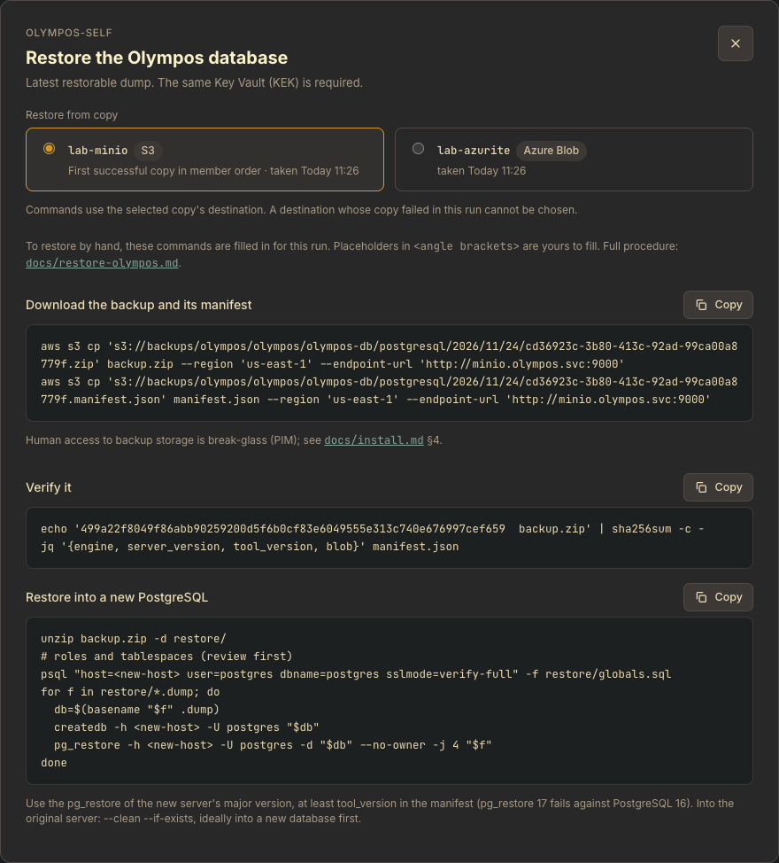

# Restoring Olympos itself

Olympos keeps its state in its own PostgreSQL database: grants, the internal CA (its private key is
sealed with the Key Vault KEK), registered clusters and agents, backup jobs and schedules, destinations
(sealed credentials), change requests and the activity log. The built-in backup job **`olympos-self`**
dumps that database (`pg_dump -Fc`) to a destination chosen in *Backups › Olympos database*.

> **The dump is useless without the Key Vault KEK.** Every secret in the database (CA key, destination
> credentials, Vault AppRole secret IDs, pending change request values) is envelope-encrypted with the
> KEK. Keep **soft delete and purge protection** on for the Key Vault (`deploy/bicep/keyvault.bicep`
> sets both; the server warns in *Needs attention* when purge protection is off). Restore points the new
> server at the **same** Key Vault and key name.

## 1. Pick the dump

Blobs are under `<prefix>/olympos/olympos/olympos-db/postgresql/YYYY/MM/DD/<run_id>.zip`, each with
`<run_id>.manifest.json` (`target.id = olympos-self`). The latest successful run is shown in
*Backups › Olympos database*; if the server is gone, list the destination:

```bash
az storage blob list --auth-mode login --account-name <account> --container-name <container> \
  --prefix "<prefix>/olympos/olympos/olympos-db/postgresql/" --query "[].name" -o tsv | sort | tail -4
az storage blob download --auth-mode login --account-name <account> --container-name <container> \
  --name "<path>/<run_id>.zip" --file olympos.zip
az storage blob download --auth-mode login --account-name <account> --container-name <container> \
  --name "<path>/<run_id>.manifest.json" --file manifest.json
sha256sum olympos.zip                 # must equal .blob.sha256 in manifest.json
unzip olympos.zip                     # olympos.dump (pg_dump custom format)
```

S3: `aws s3 cp s3://<bucket>/<path>/<run_id>.zip .`; NFS: copy from the mounted export.

**When `olympos-self` writes to a destination group**, every member holds its own copy of each dump, so
losing one storage account or bucket does not lose Olympos. Restore from whichever copy you can reach. The
copies a run wrote itself have the same path below each member's prefix; a copy a repair wrote later is the
exception: it comes from a later dump, named after the repair run, with its own checksum
([Restoring backups](restore.md#backups-with-several-copies)). Each copy's manifest names its
`destination` and the `group`; check `sha256` against that copy's own manifest. While the server is up,
*Restore commands* on the *Olympos database* card has a *Restore from copy* choice
(`GET /api/v1/backup/self?copy=<destination id>` in the API). A member whose copy failed in that run is
listed as *Failed*; when a repair wrote one there later, *use the repair's copy* switches the commands to it:



If the latest run was *Partial*, its successful copies are still a complete dump.

## 2. Restore into an empty database

Use the `pg_restore` of the PostgreSQL you restore into, whose major version must be at least `tool_version`
in the manifest. A newer `pg_restore` can fail against an older server: `pg_restore` 17 into PostgreSQL 16
stops at once with `unrecognized configuration parameter "transaction_timeout"`.

**systemd host** (local PostgreSQL, Unix socket, peer auth). The install guide adds the `postgresql-client-17`
or `postgresql17` package for backups, so give the PostgreSQL 16 `pg_restore` by its path:

```bash
sudo systemctl stop olympos-server
sudo -u postgres createuser olympos 2>/dev/null || true
sudo -u postgres createdb -O olympos olympos_restored
PG_RESTORE=/usr/lib/postgresql/16/bin/pg_restore   # Ubuntu / Debian; Rocky / Alma: /usr/pgsql-16/bin/pg_restore
sudo -u olympos "$PG_RESTORE" -d "host=/var/run/postgresql dbname=olympos_restored" --no-owner --exit-on-error olympos.dump
```

**Helm (bundled PostgreSQL)**:

```bash
kubectl -n olympos scale deploy/olympos --replicas=0
kubectl -n olympos exec statefulset/olympos-postgresql -- createdb -U olympos olympos_restored
kubectl -n olympos exec -i statefulset/olympos-postgresql -- \
  pg_restore -U olympos -d olympos_restored --no-owner --exit-on-error < olympos.dump
```

**External PostgreSQL**: create an empty database owned by the Olympos role and run the `pg_restore` of
that server's major version against it.

## 3. Point the server at it

- systemd: `database.dsn: postgres:///olympos_restored?host=/var/run/postgresql` in
  `/etc/olympos/config.yaml` (or rename the database to `olympos` and keep the default).
- Helm, bundled: rename it in place, then drop the old one once the server works:

  ```bash
  kubectl -n olympos exec statefulset/olympos-postgresql -- psql -U olympos -d postgres \
    -c 'ALTER DATABASE olympos RENAME TO olympos_old' -c 'ALTER DATABASE olympos_restored RENAME TO olympos'
  ```

  (Inside the PostgreSQL container the Unix socket is trusted; network connections need SCRAM.)
- External: update the `olympos-db-dsn` secret in Key Vault.

Keep `keyVault.name`, `keyVault.kekName` and `keyVault.hmacSecretName` exactly as before, then start the
server (`systemctl start olympos-server` / `kubectl scale deploy/olympos --replicas=1`). Migrations run
at start-up; a dump from an older version is upgraded, a dump from a **newer** version is refused.

## 4. Check

- Sign in: grants are back, so the same people have the same roles.
- *Settings › Clusters & agents*: agents reconnect by themselves within a minute (their client certificates were
  issued by the restored internal CA). A cluster stays *offline* if its agent was removed meanwhile.
- *Backups*: jobs and their schedules are back. Runs after the dump time are missing from the history,
  but their blobs are still in the destinations.
- *Approvals*: change requests opened after the dump are gone; open them again.

## Synthetic monitoring after a restore

- **Probes reconnect by themselves**, like agents. At start-up the server moves the version of the host
  allowlist past every version a probe saw before the restore, so the probes accept the restored list and
  runs resume within a minute. The allowlist, scenarios and credentials are as they were at the dump time.
- **A probe whose certificate was renewed after the dump stays pending or offline.** Olympos accepts only
  the probe certificate it last issued, and the restored database names an older one. The agent renews the
  probe's certificate every 20 days, so with an older dump this is most clusters; a probe enrolled after
  the dump is not in the restored database at all. Its `probe.offline` alert fires after
  `synthetic.probeOfflineAlertAfter`. In *Settings › Clusters & agents*, choose **Install probe** on each of
  these clusters and run the command it shows.
- **Credentials rotated after the dump must be rotated again.** A credential stored in Olympos holds the
  value it had at the dump time: open it in *Settings › Synthetic monitoring › Credentials*, tick **Rotate
  the secret** and enter the current one. Credentials created after the dump are gone; create them again.
  A Key Vault reference reads the current secret and needs nothing.

See [Synthetic monitoring](synthetic-monitoring.md).

## If the KEK is lost

Without the KEK no sealed value can be opened: the internal CA key, destination credentials and Vault
AppRole secret IDs are unrecoverable. Recover the key from Key Vault soft delete
(`az keyvault key recover`). If it was purged, install Olympos fresh and re-enroll every cluster; the
backup blobs of your targets are not encrypted by Olympos and stay usable (`docs/restore.md`).
