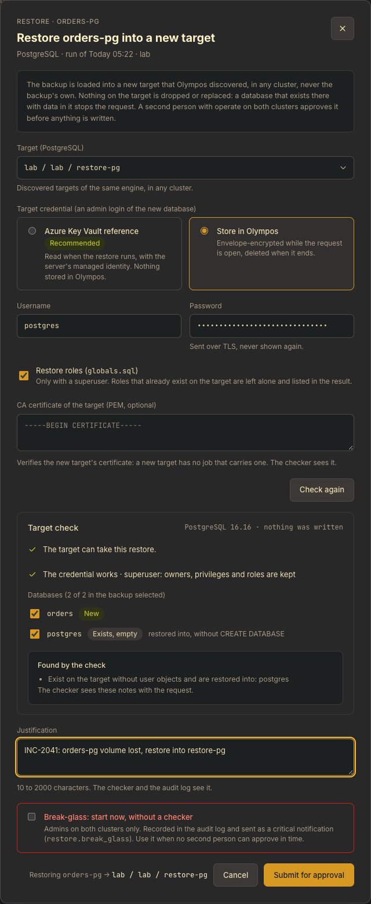
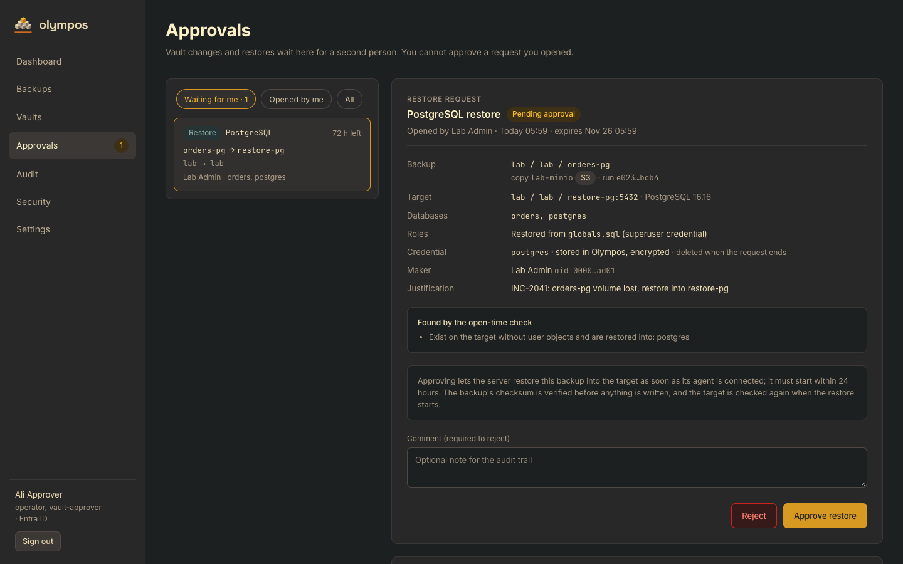
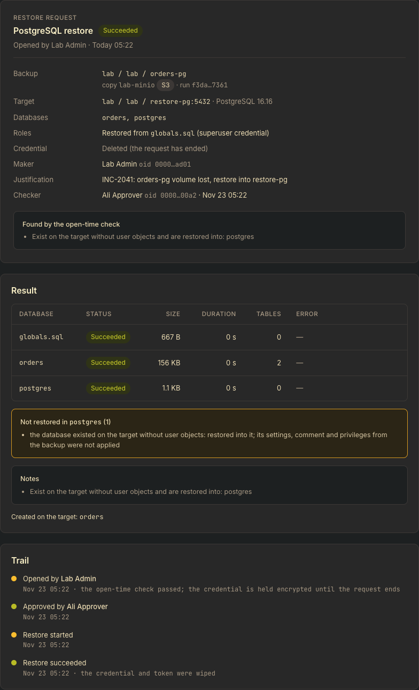
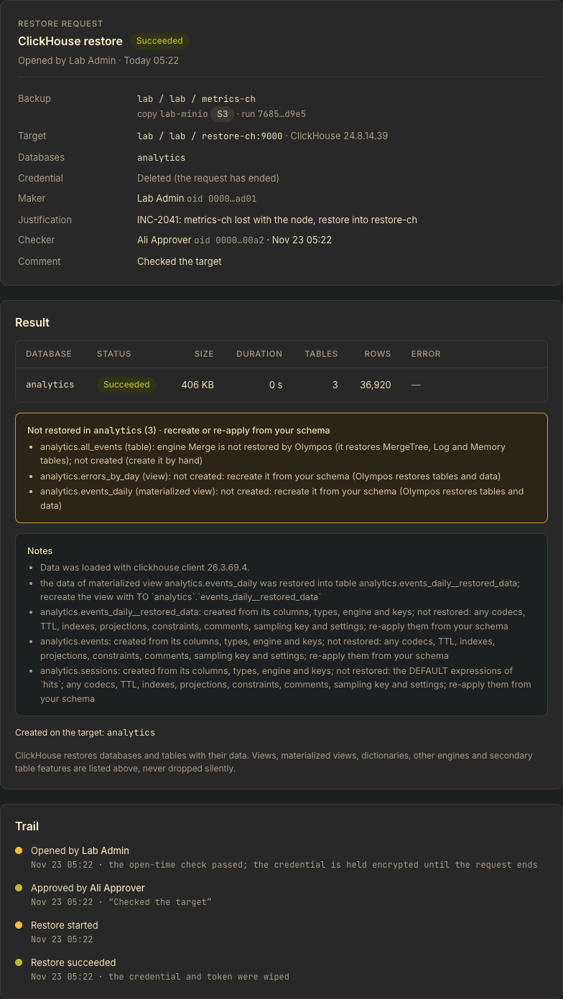
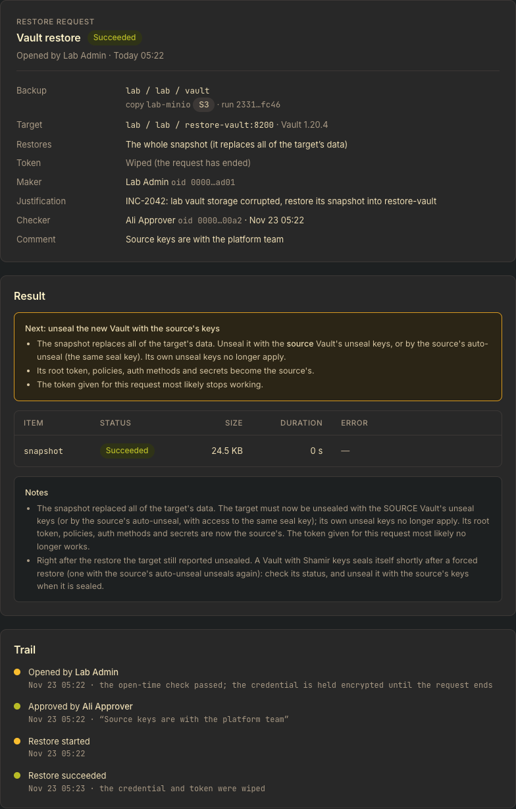

# Restoring backups

A backup is restored into a **new server**, never over the one it came from. There are two ways:

- **From the UI** ([below](#restore-from-the-ui)): pick a run, a new target Olympos discovered and the
  target's admin login; a second person approves; the server verifies the backup and restores it through the
  target's agent tunnel. This is the quickest way in a disaster, and nothing is written before a second
  person agrees (or an admin uses the recorded break-glass path).
- **By hand** ([Restore by hand](#restore-by-hand)): the details of every successful run show the download,
  checksum and restore commands, filled in for that run. Use them to restore somewhere Olympos does not
  reach, into the original server, or to restore what the UI does not (single tables, ClickHouse views and
  dictionaries).

## Restore from the UI

A UI restore is a **restore request**: someone opens it from a backup run, another person approves it, and
the server runs it. It copies production data into another system, so it follows the same maker/checker
rule as Vault changes. The request, the decision and every step are in the audit log.

### Before you start

1. **Deploy the new server** (PostgreSQL, ClickHouse, or Vault/OpenBao with raft storage) in any cluster
   that has an Olympos agent; the backup's own cluster may be gone. Annotate its Service like any target
   (`olympos.io/backup: postgresql`, `clickhouse` or `vault`, plus `olympos.io/vault` and
   `olympos.io/tls-server-name` as needed; see [Installing on Kubernetes](install.md)) and wait until its
   agent reports it. Olympos does not create targets, namespaces or users.
2. **Have the new server's admin login** at hand: a PostgreSQL or ClickHouse user that may create databases,
   or, for Vault, a token of the **new** Vault (see [Vault and OpenBao](#what-a-vault-or-openbao-restore-does)).
   Give it as a Key Vault reference or store it in Olympos for the request: either way it is encrypted while
   the request is open and **deleted in every way the request ends** (succeeded, failed, rejected, expired,
   withdrawn). It is never shown again, not even to the checker.
3. **Roles.** The person who opens the request (the *maker*) needs `read` on the backup's cluster and
   `operate` on the target's cluster. The *checker* must be **another person** with `operate` on **both**
   clusters, and not a guest; an admin cannot approve their own request either. People are compared by
   tenant and object ID ([Access](access.md#maker-and-checker)).

### Open the request

On **Backups › Runs**, open a succeeded or partial run (not a dry run) and choose **Restore…**. For a run with
several copies, pick the copy to read. Then choose the **target**: discovered targets of the same engine,
in any cluster, except the backup's own and, for Vault, any Vault that is configured in Olympos. Enter the
credential, an optional CA certificate to verify the new target's TLS certificate, and choose **Check
target**.

The check connects to the target through its agent with the credential you gave, without writing anything,
and shows what it found: the server version, whether the credential is a superuser (PostgreSQL), which
databases in the backup already exist on the target, and, for Vault, whether it is initialized, unsealed,
the active node and whether the token may restore a snapshot. Every check is recorded in the activity log
(`restore.checked`). PostgreSQL and ClickHouse restores let you choose which databases of the backup to
restore; all of them are selected by default.



Add a justification (10 to 2000 characters: what happened, an incident or ticket number) and choose
**Submit for approval**. The request waits on **Approvals** for a checker. A pending request **expires**
after `changeRequests.ttl` (72 hours by default, the same as Vault change requests) and its credential is
deleted. The maker can **Withdraw** it while it is pending, or approved and not yet started.

### Approve it

The checker finds the request on **Approvals** (*Waiting for me*), next to Vault change requests. It shows
the backup and its copy, the target and its server version, the databases, whether roles are restored, the
credential's user name (never the password), the CA certificate if one was given, the maker, the
justification and what the check found.



**Approve restore** lets the server start it as soon as the target's agent is connected to this server.
An approved request that has not started within **24 hours** (the agent stayed away, for example) expires,
which frees the target and deletes the credential. **Reject** needs a comment and also deletes the
credential.

**Break-glass.** An admin on **both** clusters can tick *Break-glass: start now, without a checker* in the
dialog. The request is approved at once, with the maker recorded as the decider, and the critical event
`restore.break_glass` is sent with the justification. Guests cannot use it. Use it when no second person can
approve in time, and route `restore.break_glass` to a channel someone watches
([Findings and events](findings-and-events.md#events-and-notifications)).

### What the server does

1. **Verifies the backup before writing anything:** one full pass over the copy computes its SHA-256 and
   compares it with the run's copy and its manifest. A mismatch fails the request before the target is
   touched. While restoring, every zip entry's CRC-32 is checked as well.
2. **Checks the target again**, because time passes between approval and start: the same checks as when the
   request was opened, with the same credential.
3. **Restores** through the target's agent tunnel, reading the copy straight from its destination: no
   temporary files, nothing sent to the cluster but the target's own protocol. The request shows progress
   (the database or table, bytes read) and then a result per database, or for the snapshot: status, size,
   duration, tables (and rows for ClickHouse), errors, and what was **not** restored, with the reason.
4. **Never overwrites.** A database that already exists on the target **with user objects in it** stops the
   request (when it is opened and again when it starts). An existing database **without** user objects (the
   `postgres` or `default` database of a fresh server, for example) is restored into. Nothing on the target
   is dropped or replaced. After a failure, the databases the restore created stay on the target and are
   listed in the result: drop them before you try again.

The check and the start need the target cluster's agent to be connected to the Olympos server that handles
them. This is checked per server replica: with more than one replica (`experimental.multiReplica`), a check
that lands on a replica the agent is not connected to answers `agent_offline`, and an approved request waits
for the replica that has the agent.

One restore at a time per target: while a request into a target is approved or running, another one into
the same target is refused until it ends. A server runs at most two restores at once, and running restores
count against the target cluster's `backup.perClusterConcurrency` together with its backups. There are no
retries: a failed restore is a new request (often with another target or credential).

**When the server stops during a restore.** A restore whose server cannot finish it fails, and the error
says that part of the data may have been written. The databases created so far are listed: check the
target and drop them before you open a new request.

- `interrupted: server stopped during the restore`: the server shut down while it restored.
- `interrupted: the server running the restore stopped or lost contact with Olympos' database`: the
  request showed no progress for 5 minutes and was not running on any server, so a server (another
  replica, or this one after a restart) failed it and freed the target.
- `stopped: this server lost contact with Olympos' database for <duration>`: the server could not write the
  restore's progress for 4 minutes and stopped the restore itself. After 5 minutes another replica may fail
  the request and free the target, so the server stops writing to the target before that. A server never
  fails a restore it is still running, and a restore whose request was failed elsewhere stops at its next
  progress write without recording anything more.



### What a PostgreSQL restore does

- **`pg_restore` matches the target**, not the backup: the server uses the `pg_restore` of the target's
  major version (from `backup.pgDumpDir`), and the dump's major version must be the same or older than the
  target's. A dump of PostgreSQL 17 cannot be restored into PostgreSQL 16; the check says so before the
  request is opened.
- **Roles (`globals.sql`) only with a superuser.** With a superuser credential the roles of the backup are
  created first, then each database is created (owner, encoding and locale from the dump) and restored with
  its owners and privileges. A role that **already exists** on the target is left alone, with all its
  statements, so the target's admin login and the roles you manage are never changed; tablespaces are not
  created (`pg_restore --no-tablespaces`). Both are listed in the result.
- **Without a superuser** (CloudNativePG's default application user, for example) roles are skipped and the
  databases are restored with `--no-owner --no-privileges`: the credential's user owns everything. The
  check, the request (the checker sees it) and the result say so. You can also turn roles off for a
  superuser in the dialog.

### What a ClickHouse restore does

> **ClickHouse restores are deliberately conservative.** Olympos restores **databases and tables with their
> data**, and it **generates** every `CREATE DATABASE` and `CREATE TABLE` itself from the backup's manifest:
> **no SQL text from the backup runs on the target.** Everything else is reported, never dropped silently,
> so you can recreate or re-apply it from your schema (migrations, Terraform, the backup's `schema/*.sql`
> entries).

- **Created, with their data:** databases (`ENGINE = Atomic`), and tables of the MergeTree family
  (`MergeTree`, `ReplacingMergeTree`, `SummingMergeTree`, `AggregatingMergeTree`, `CollapsingMergeTree`,
  `VersionedCollapsingMergeTree`), their `Replicated*` variants, `Log`, `TinyLog`, `StripeLog` and
  `Memory`. Each table gets its ordinary columns and types, its engine and its sorting, partition and
  primary keys when they are plain columns (a partition key `toYYYYMM(col)`, `toYYYYMMDD(col)`, `toDate(col)`
  or `toStartOfMonth(col)` is kept too). Rows written are compared with the rows in the backup per table.
- **Not created, listed by name and reason only:** views, materialized views, dictionaries, live and window
  views, `GraphiteMergeTree`, and tables of any other engine (Kafka, S3, URL, MySQL, PostgreSQL,
  Distributed, Merge, Buffer, Join, Set, KeeperMap, EmbeddedRocksDB, …). Their DDL is not shown.
- **Not restored on the tables that are created, listed per table ("re-apply from your schema"):** column
  `DEFAULT` expressions, `MATERIALIZED`, `ALIAS` and `EPHEMERAL` columns, TTL, skip indexes, projections,
  constraints, codecs, comments, the sampling key, table settings, and keys that are not plain columns (a
  `MergeTree` table then gets `ORDER BY tuple()`).
- **Not created, data not restored, listed with the reason; the rest of the database is restored** (and
  its result still says *Succeeded*, so read the list): `Replacing`, `Summing`, `Aggregating`, `Collapsing`
  and `VersionedCollapsing` tables (and their `Replicated*` variants) whose keys or engine parameters are
  expressions (an `ORDER BY tuple()` would merge
  their rows differently), and tables with a column type outside the supported list. Restore their data by
  hand from the backup ([Restore by hand](#clickhouse)).
- **The whole request fails before anything is written:** a database with the `Replicated` engine (its
  Keeper path could collide with the source's), a database whose engine is a proxy for another system
  (`MySQL`, `PostgreSQL`, `MaterializedPostgreSQL`, `SQLite`, …), and a database that already exists on the
  target with tables, views or dictionaries in it. The result names the database and the reason; the other
  databases of the request are listed as *Skipped*. Leave such a database out of the selection. Other
  database engines (`Ordinary`, `Lazy`, `Memory`) are created as `Atomic`, and the result notes it.
- **Materialized views:** the data of a view without `TO` is restored into a table named
  `<view>__restored_data`; recreate the view with `TO` that table. A view with `TO` needs only to be
  recreated: its target is a table of the backup.
- **Replicated tables** get a Keeper path that Olympos generates, `/olympos-restore/<request id>/<db>/<table>`
  (replica `{replica}`), so they share no Keeper state with the source. The target needs Keeper and the
  `{replica}` macro.
- **Errors** from the target are reported as code and name only (for example `Code 36 BAD_ARGUMENTS`), never
  with the server's message.
- The data goes through the pinned `clickhouse client` in the server image (`backup.clickhouseClient`), which
  reads every format the backup uses.



### What a Vault or OpenBao restore does

A Vault restore loads the backup's raft snapshot with `snapshot-force`. It is **all or nothing**: there is no
database selection, and it replaces all of the target's data.

- **The target** must be a new Vault or OpenBao with raft storage that is **not configured in Olympos**,
  initialized, unsealed, and the **active node** (point the target at a Service that selects only the active
  pod; a standby would redirect the upload).
- **The token** is a token of the new Vault. It needs the `default` policy (Olympos reads its capabilities
  with `sys/capabilities-self`) plus **both `update` and `sudo`** on `sys/storage/raft/snapshot-force`, or it
  is the new Vault's root token:

  ```hcl
  path "sys/storage/raft/snapshot-force" { capabilities = ["update", "sudo"] }
  ```

  It is sealed until the request ends, then wiped.
- **After the restore the target holds the source's data, encrypted with the source's keys.** Right after
  `snapshot-force` it may still report unsealed; a Vault with Shamir keys seals itself shortly after (or at
  its next restart), and the result notes which state it saw. Unseal it with
  the **source** Vault's unseal keys (or let the source's auto-unseal do it, with access to the same seal
  key); its own unseal keys no longer apply. Its root token, policies, auth methods and secrets are now the
  source's, and the token given for the request most likely stops working. The result says so:

  ```bash
  vault operator unseal      # with the SOURCE's unseal keys, as often as its threshold requires
  vault status               # Sealed: false
  ```



### Events, audit and API

- Events (none is opt-in; nothing is routed until you route it): `restore.requested`, `restore.approved`,
  `restore.rejected`, `restore.started`, `restore.succeeded`, `restore.failed` and `restore.break_glass`
  ([Findings and events](findings-and-events.md#events-and-notifications)). Route at least
  `restore.failed` and `restore.break_glass`. An upgrade routes these two to every channel that gets
  `backup.failed`.
- **Who sees a request:** people with `read` on the **backup's** cluster. Its audit rows and events are
  recorded on that cluster too, because they name the backup's run and databases; `read` on the target's
  cluster alone shows nothing.
- API: `POST /api/v1/restores/check` (the dialog's check, nothing stored), `POST /api/v1/restores` (open;
  `break_glass: true`), `GET /api/v1/restores`, `GET /api/v1/restores/{id}`, and
  `POST /api/v1/restores/{id}/approve`, `/reject`, `/cancel` ([REST API](openapi.yaml)). Credentials and
  tokens are write-only.
- Olympos' own database (`olympos-self`) is not restored from the UI: see
  [Restoring Olympos](restore-olympos.md).

## Restore by hand

The sections from here on are the procedures by hand: the backup format of each engine, and the commands to
download, verify and restore a copy yourself ([PostgreSQL](#postgresql), [Vault / OpenBao](#vault--openbao-raft),
[ClickHouse](#clickhouse)). A run's restore commands link to them.

The details of every successful run in *Backups* (click the run) show these commands already filled in for
that run: download from its destination, checksum, restore. Every backup blob comes with a
`{run_id}.manifest.json` written by the server (sha256, size, engine, versions, timestamps). Blob data-plane
access for humans is break-glass only (PIM, SPEC §10.3.1). Download the backup and check it before restoring:

```bash
az storage blob download --auth-mode login --account-name <account> --container-name <container> \
  --name "<prefix>/<cluster>/<namespace>/<service>/<engine>/YYYY/MM/DD/<run_id>.<ext>" --file backup.<ext>
sha256sum backup.<ext>   # must match "sha256" in <run_id>.manifest.json
```

## Backups with several copies

A job that writes to a **destination group** stores each run once in every member. Every successful copy is
a complete backup with its own manifest, so restore from whichever copy you can reach.

- **Choosing a copy.** A run's details list its *Copies* (destination, status, size, SHA-256, tier, error).
  *Restore from copy* picks the copy the commands are built from; they then download from that copy's
  destination. The default is the first successful copy in the group's member order. A destination whose
  copy failed in this run is listed as *Failed* and cannot be chosen, even when its data blob was written
  (only the manifest failed, so the copy cannot be verified).
- **The same in the API.** `GET /api/v1/backup/runs/{id}?copy=<destination id>` returns the run with the
  restore guide for that copy; `restore.copies` lists every copy it can be built from, with `selected` on
  the one in use. For `olympos-self`, use `GET /api/v1/backup/self?copy=<destination id>`. A destination
  without a successful copy of the run answers `422`.
- **Copies completed by a repair.** When a run was `partial`, a repair run writes the missing copies later:
  5 minutes after the run, or after 30 minutes or 2 hours more when the first repairs failed
  ([Findings and events](findings-and-events.md#partial-backups-and-repairs)). In the original run's
  *Restore from copy*, that destination stays *Failed*; its line says when a repair wrote a copy there and
  links to the repair run, whose details have the restore commands for it. A repaired copy is a
  **different, later dump**:
  its blob and manifest are named after the repair run (`<repair_run_id>.<ext>`,
  `<repair_run_id>.manifest.json`, in the folder of the day the repair started), and its `sha256` differs
  from the other copies. Verify it against its own manifest.
- **Which copy is which.** Each manifest names the destination it was written to and, for a group, the
  group and its members in order:

  ```json
  "destination": {"name": "lab-azurite", "kind": "azure_blob"},
  "group": {"name": "lab-copies", "members": ["lab-minio", "lab-azurite"]}
  ```

  Runs of a single-destination job have `destination` and no `group`. Manifests written before destination
  groups have neither.

The commands differ by kind: `az storage blob download` for Azure Blob, `aws s3 cp` for S3, and a plain copy
from the mounted export for NFS. The run's details fill them in for the copy you choose.

## PostgreSQL

### What a backup contains

`<run_id>.zip` (stored, not re-compressed — `pg_dump -Fc` output is already compressed):

| Entry | Content |
|---|---|
| `globals.sql` | `pg_dumpall --globals-only` (roles, tablespaces). Role passwords are included as hashes. |
| `<db>.dump` | `pg_dump -Fc` of one database (custom format, restore with `pg_restore`) |

The manifest records the server version and the pg_dump version used (`server_version`, `tool_version`).
Use `pg_restore` with a major version ≥ the dump's.

### Restore

```bash
unzip backup.zip -d restore/
# 1. Roles and tablespaces (review first: it may contain roles you do not want on the new server).
psql "host=<new-host> user=postgres dbname=postgres sslmode=verify-full" -f restore/globals.sql
# 2. Each database.
createdb -h <new-host> -U postgres orders
pg_restore -h <new-host> -U postgres -d orders --no-owner --role=<owner> -j 4 restore/orders.dump
# Inspect without restoring:
pg_restore --list restore/orders.dump | head
```

Restoring into the original server: add `--clean --if-exists` to `pg_restore`, ideally into a new database
that you then swap in by renaming. Dry-run (`olympos-tier=test`) blobs contain globals plus schema only.

## Vault / OpenBao (raft)

### What a backup contains

`<run_id>.snap`: the raw output of `GET /v1/sys/storage/raft/snapshot`, encrypted by Vault's barrier. It can
only be restored into a cluster that can be unsealed with the **same unseal/recovery keys**.

### Restore

```bash
export VAULT_ADDR=https://vault.example:8200
# Needs a token with sys/storage/raft/snapshot-force (break-glass root token, see runbooks/vault-break-glass.md).
vault operator raft snapshot restore -force backup.snap     # OpenBao: bao operator raft snapshot restore -force
vault operator unseal   # if the cluster seals after restore
vault token revoke -self
```

After a restore the Olympos AppRole and policy are those of the snapshot time. If the AppRole's secret_id was
rotated since, run *Vaults › Configure* again. Expect `vault-drift` findings for every version written after
the snapshot (they are now "missing"), which is correct: review and resolve them.

## ClickHouse

### What a backup contains

A ClickHouse backup is a zip (`<run_id>.zip`) written front to back by the server over the native protocol.
Entries:

| Entry | Content |
|---|---|
| `schema/<db>.sql` | `CREATE DATABASE` (`SHOW CREATE DATABASE`) |
| `schema/<db>/<object>.sql` | `CREATE TABLE / VIEW / MATERIALIZED VIEW / DICTIONARY` (`SHOW CREATE ...`) |
| `data/<db>/<table>/<partition_id>.native` | rows of one partition (`all` = whole table), ClickHouse **Native** format |
| `data/<db>/<table>/<partition_id>.rowbinary` | same, **RowBinaryWithNamesAndTypes**. Used for tables with a column type the Native block codec cannot stream (for example `AggregateFunction`, `Tuple`, `Variant`/`Dynamic`/`JSON`, `LowCardinality(Nullable(...))`). The table's `fallback_reason` in the manifest says which column. |
| `manifest.json` | written last: objects, kinds, columns, partitions, row counts, sha256 per data entry, `restore_order` |

Names in entry paths are escaped (anything outside `[A-Za-z0-9_.-]` becomes `%XX`). Always read the real
database and table names, and the entry paths, from `manifest.json`.

Useful manifest fields (`.databases[].tables[]`):

- `kind`: `table`, `dictionary`, `view`, `materialized_view`, `materialized_view_inner` (the `.inner_id.<uuid>`
  table of a materialized view without `TO`; it is created by its view, see `inner_of`), `other`.
- `has_data`, `data_format` (`Native` or `RowBinaryWithNamesAndTypes`), `data_note` (why there is no data:
  views, engines without local data such as `Distributed`, `Merge`, `Buffer`, `Kafka`, `S3`, `MySQL`, ...).
- `partitions[]`: `id`, `entry` (empty when the partition had no rows), `rows` (streamed), `rows_expected`
  (from `system.parts` at backup start, or from `count()`: see `rows_source`), `sha256` of the entry content.
- `restore_order`: `db.object` in creation order: tables, then dictionaries, then views and materialized views.

A dry run (`"dry_run": true`) contains schema and manifest only.

Things the backup does **not** contain, by design:

- **Secrets in DDL.** `SHOW CREATE` masks credentials of external sources (dictionary `SOURCE(... PASSWORD ...)`,
  `MySQL`/`PostgreSQL`/`S3`/`URL` engines, named collections) as `'[HIDDEN]'`. Put them back before running the
  statement.
- **UUIDs.** Statements are portable (no `UUID '...'`); the original UUIDs are in the manifest for reference.
- **Users, roles, quotas, settings profiles, named collections.** Recreate them separately.
- **A point-in-time snapshot.** Each data entry is one `SELECT` (one partition, or the whole table). Writes during
  the backup can make partitions disagree by a few rows; the manifest lists them under `warnings`.

Each ClickHouse target is backed up through one service. On a sharded cluster, back up each shard (each
shard's service) separately; for replicated tables one replica per shard is enough.

### Restore, step by step

You need `unzip`, `jq` and a `clickhouse-client` matching the target server. Keep the connection settings in a
client config file rather than on the command line:

```bash
ZIP=backup.zip
CH=(clickhouse-client --config-file ./restore-client.xml)   # host, port 9440, secure, user, password
manifest() { unzip -p "$ZIP" manifest.json; }

manifest | jq '{server_version, started_at, dry_run, rows_source, warnings, totals}'
manifest | jq -r '.databases[].tables[] | [.kind, .name, .data_format // "-", .rows] | @tsv'
```

1. **Optional: verify entries** against the manifest:

   ```bash
   manifest | jq -r '.databases[].tables[].partitions[]? | select((.entry // "") != "") | [.sha256, .entry] | @tsv' |
   while IFS=$'\t' read -r sum entry; do
     [ "$(unzip -p "$ZIP" "$entry" | sha256sum | cut -d' ' -f1)" = "$sum" ] || echo "MISMATCH $entry"
   done
   ```

2. **Create the databases** (edit the statement to restore under another name or engine):

   ```bash
   unzip -p "$ZIP" schema/shop.sql | "${CH[@]}" --multiquery
   ```

3. **Create the tables** (`kind == "table"`), in `restore_order`:

   ```bash
   unzip -p "$ZIP" schema/shop/events.sql | "${CH[@]}" --multiquery
   ```

   For `Replicated*MergeTree` tables, make sure the ZooKeeper/Keeper path and replica name do not collide
   with live tables (edit the statement), create the table on every replica, and load data on **one** replica.

4. **Load the data** of each table, one entry per partition:

   ```bash
   unzip -p "$ZIP" data/shop/events/202401.native   | "${CH[@]}" --query "INSERT INTO shop.events FORMAT Native"
   unzip -p "$ZIP" data/shop/agg/all.rowbinary      | "${CH[@]}" --query "INSERT INTO shop.agg FORMAT RowBinaryWithNamesAndTypes"
   ```

   The files hold the columns `SELECT *` returns; `MATERIALIZED` columns are recomputed on insert, `ALIAS`
   columns are not stored. Columns are matched by name.

5. **Create dictionaries, views and materialized views** (the remaining objects of `restore_order`). Create
   materialized views **after** loading the tables so they do not re-ingest the restored rows.

6. **Load materialized view data.** For a view without `TO` (its data is the `materialized_view_inner` table),
   insert into the view itself; this writes straight into its new inner table without running the view's query:

   ```bash
   unzip -p "$ZIP" "data/shop/.inner_id.<uuid>/all.native" | "${CH[@]}" --query "INSERT INTO shop.mv_daily FORMAT Native"
   ```

   Views with `TO db.target` need nothing extra: the target is an ordinary table restored in step 4.

7. **Check row counts** against `rows` in the manifest:

   ```bash
   "${CH[@]}" --query "SELECT count() FROM shop.events"
   ```

### Everything at once

Restores every database of the backup under its original name (the target databases must not exist). Save it
as `restore-clickhouse.sh`: the restore commands shown for each run in *Backups* call it by that name.
Review it first, in particular for `[HIDDEN]` secrets and replicated tables.

```bash
#!/usr/bin/env bash
set -euo pipefail
ZIP=${1:?backup.zip}
CH=(clickhouse-client --config-file ./restore-client.xml)
manifest() { unzip -p "$ZIP" manifest.json; }

# objects of the given kinds, in restore_order: db <TAB> name <TAB> schema entry
objects() {
  manifest | jq -r --arg kinds "$1" '
    ([.databases[] | .name as $db | .tables[] | {key: ($db + "." + .name), value: (. + {db: $db})}] | from_entries) as $t
    | .restore_order[] | $t[.] | select(.kind as $k | $kinds | split(",") | index($k))
    | [.db, .name, .schema_entry] | @tsv'
}
# data entries of the given kinds: db <TAB> insert target <TAB> format <TAB> entry
entries() {
  manifest | jq -r --arg kinds "$1" '
    .databases[] | .name as $db | .tables[] | select(.has_data) | select(.kind as $k | $kinds | split(",") | index($k))
    | . as $t | .partitions[] | select((.entry // "") != "")
    | [$db, ($t.inner_of // $t.name), $t.data_format, .entry] | @tsv'
}
q() { local s=${1//\\/\\\\}; s=${s//\`/\\\`}; printf '`%s`' "$s"; }   # quote an identifier

for e in $(manifest | jq -r '.databases[].schema_entry'); do unzip -p "$ZIP" "$e" | "${CH[@]}" --multiquery; done
objects table | while IFS=$'\t' read -r db name entry; do unzip -p "$ZIP" "$entry" | "${CH[@]}" --multiquery; done
entries table | while IFS=$'\t' read -r db table fmt entry; do
  unzip -p "$ZIP" "$entry" | "${CH[@]}" --query "INSERT INTO $(q "$db").$(q "$table") FORMAT $fmt"
done
objects dictionary,view,materialized_view,other | while IFS=$'\t' read -r db name entry; do
  unzip -p "$ZIP" "$entry" | "${CH[@]}" --multiquery
done
entries materialized_view_inner | while IFS=$'\t' read -r db table fmt entry; do
  unzip -p "$ZIP" "$entry" | "${CH[@]}" --query "INSERT INTO $(q "$db").$(q "$table") FORMAT $fmt"
done
```

Views that select from other views may need to be created in a different order than `restore_order` (which
sorts views by name); re-run the failed statements once the others exist.

To restore into **another database name**, create the new database yourself and rewrite the qualified names
(`old_db.` → `new_db.`) in the statements, including inside view and materialized view queries, then insert
into `new_db.<table>`.

### Large datasets (v2)

This logical backup (`SELECT ... FORMAT Native` per partition) is slower than ClickHouse's native `BACKUP` for
very large datasets, and restore re-inserts every row. A later version may add an S3-compatible ingest
endpoint on the Olympos server so that ClickHouse can run `BACKUP DATABASE ... TO S3('https://olympos/...')`
against Olympos itself (and `RESTORE ... FROM S3(...)` through it), while the server stays the only writer to
Blob storage and ClickHouse still never receives a Blob credential.
