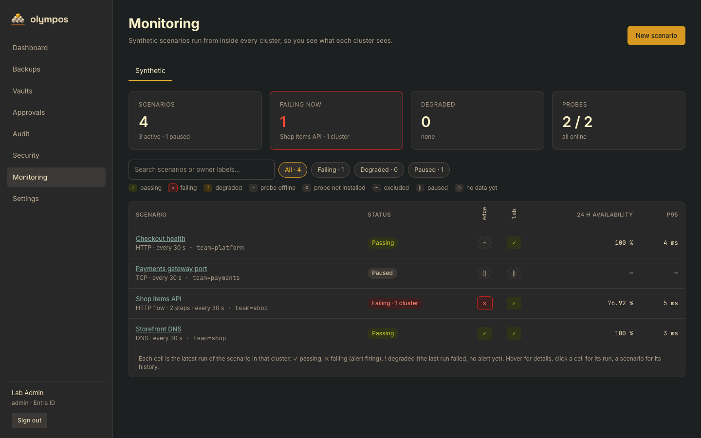
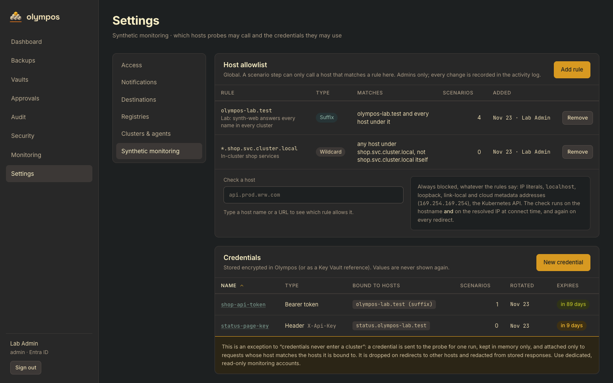
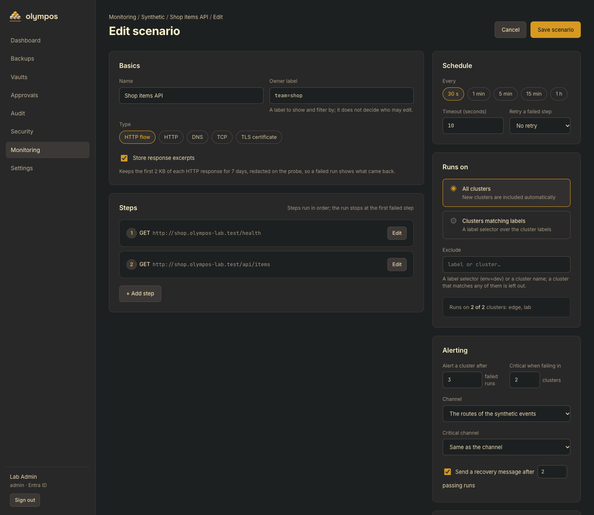
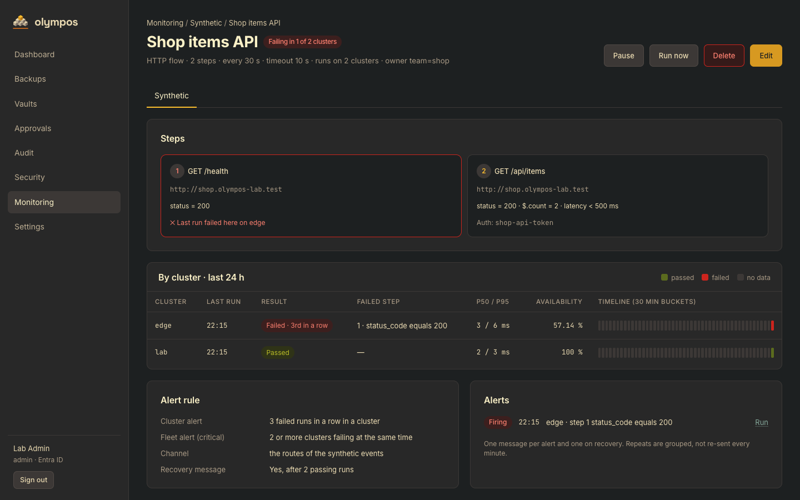
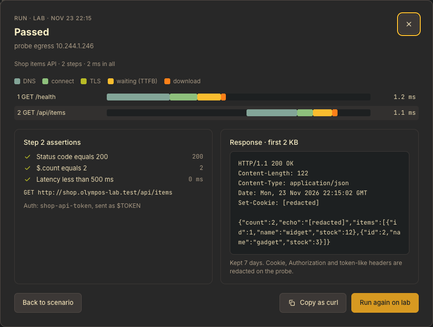

# Synthetic monitoring

A **scenario** is a check you define once in Olympos: an HTTP request, a flow of several requests, a DNS
lookup, a TCP connect or a TLS handshake, with assertions on the result. It runs **from inside every
cluster** you choose, on a schedule, so you see what each cluster sees: a partner API that one region
cannot reach, a certificate about to expire, a login flow that broke on one cluster only. When a scenario
keeps failing, Olympos alerts a notification channel; when it passes again, it says so.

- [How it works](#how-it-works)
- [Install the probe](#install-the-probe)
- [Allow hosts](#allow-hosts)
- [Credentials](#credentials)
- [Write a scenario](#write-a-scenario)
- [Read the results](#read-the-results)
- [Alerts](#alerts)
- [Rate caps](#rate-caps)
- [Who can do what](#who-can-do-what)
- [Retention](#retention)
- [After a restore of Olympos](#after-a-restore-of-olympos)
- [Try it in the lab](#try-it-in-the-lab)



## How it works

```
olympos-server ──mTLS gRPC──▶ olympos-agent    (unchanged: inventory, tunnels, audits)
      ▲
      └──────mTLS gRPC─────── olympos-probe    (dials out, one Deployment per cluster)
                                   │
                                   └── HTTP / DNS / TCP / TLS ──▶ allowlisted hosts only
```

- Scenarios run in **`olympos-probe`**, a separate Deployment next to the agent. The agent's role does not
  change. The probe has a ServiceAccount with no RBAC and no token, so it cannot talk to the Kubernetes API.
- The probe dials out to the same gateway as the agent, with an identity of its own (certificate CN
  `<cluster-uuid>/probe`). That identity may only run scenarios: no tunnels, no inventory, no API proxy.
- The **server** schedules every run (one leader, like backups). Runs of a scenario are spread over its
  interval with a stable offset per cluster (±10 % of the interval), so clusters do not all fire at the same
  second. Each run carries the current host allowlist and, sealed for that run only, the credentials its
  steps use.
- The probe resolves each name once, checks every address, connects to the address it checked, runs the
  steps, redacts the responses and sends back timings, assertion results and short excerpts. Extracted
  values are never sent back; only their names are.
- A probe that is offline is never counted as a failure: its cells read *probe offline*, it gets no new
  runs, and runs that were already scheduled for it end *skipped* (`probe_offline`).

Scenarios that log in need credentials, and those credentials go into the cluster for the run. This is a
documented exception to Olympos' rule that credentials never enter a cluster; see
[Security model](security-model.md#synthetic-monitoring-credentials-in-the-cluster) for how it is
contained.

## Install the probe

**New clusters.** The *Add cluster* command installs the probe together with the agent (`probe.enabled: true`
in the agent chart). The same one-time token enrolls the agent and then the probe.

**Clusters added before v0.3.** `helm upgrade` of the agent chart adds the probe Deployment, which waits
without an identity; the cluster shows *Probe: not installed*. An admin with scope `all` opens
**Settings › Clusters & agents**, chooses **Install probe** on the cluster and runs the command it shows: a
`helm upgrade … --reuse-values` with a probe-only one-time token (valid for an hour) and the server's
install sets (`OLYMPOS_AGENT_INSTALL_SETS`, for image mirrors). A cluster that waits for its first agent
gets no probe token: its *Add cluster* command already installs the probe.

**Opting out.** `--set probe.enabled=false` installs no probe; the cluster shows *Probe: not installed* and
scenarios skip it.

The *Status* column of *Settings › Clusters & agents* shows the probe next to the agent: online with its
version, offline, pending (enrolled, not connected yet), not installed or revoked. A scope-all admin can
**Revoke probe** there: the probe's certificate stops working at once and the agent keeps working.
Revoking a probe on a cluster that has none answers *409 no probe installed*.

### The probe's identity

The probe cannot store or renew a certificate itself (it has no Kubernetes API access), so **the agent
keeps it**:

- The agent enrolls the probe once its own identity exists, writes the probe's certificate and key to the
  Secret `olympos-probe-identity` and renews them like its own (at two thirds of their 30-day lifetime). The
  agent's Role gains this one Secret name.
- The probe mounts that Secret read-only, the key with mode 0440 for group 65532 (the probe's group), and
  reloads it when it changes. After a renewal the probe reconnects within the kubelet's sync period plus
  30 seconds; that gap never raises an alert.
- Only the probe's **current** certificate can connect. If a renewal's answer is lost, the agent retries the
  renewal with the previous certificate until the new one has connected once.
- *Install probe* writes the new token into the same Secret; the agent then enrolls the probe again, even
  over a certificate that still looks valid. This also recovers a revoked probe.

Known limitations of the chart, the same as for the agent's own Secret `olympos-agent-identity`:

- `helm rollback` restores old Secret data, so the probe loses the certificate the agent wrote. Use
  *Install probe* afterwards.
- The chart renders `olympos-probe-identity` with what is in it on every upgrade, so the probe's key (and
  the last probe token) end up in the Helm release history. The chart never writes the same token twice,
  so `--reuse-values` does not replay a spent one.
- GitOps tools that render charts without Helm's `lookup` can overwrite the Secret. Exclude
  `olympos-probe-identity` from pruning and diffing.

### NetworkPolicy

`probe.networkPolicy.egressCIDRs` (agent chart) adds a NetworkPolicy that lets the probe reach only these
CIDRs and the cluster DNS. Include the gateway (`server`) and every allowlisted host. On OpenShift, or with
NodeLocal DNSCache, set `probe.networkPolicy.dns`
([Configuration](configuration.md#agent-helm-values-deployhelmolympos-agent)). The allowlist in Olympos
applies either way.

## Allow hosts

A probe may only call hosts on the **host allowlist**: **Settings › Synthetic monitoring › Host allowlist**,
global, changed by admins with scope `all` only. Every change is in the activity log and sends
`synthetic.allowlist_changed` (the upgrade that adds it routes it wherever `grant.changed` goes).

| Kind | Example | Matches | Does not match |
|---|---|---|---|
| `exact` | `partner-sftp.acme.net` | that host only | anything else |
| `wildcard` | `*.dev.wrw.com` | any host under `dev.wrw.com`, at any depth (`a.dev.wrw.com`, `x.y.dev.wrw.com`) | `dev.wrw.com` itself |
| `suffix` | `wrw.com` | `wrw.com` and every host under it | `notwrw.com`, `wrw.com.evil.io` |

Hosts are compared lower-cased, IDNA-normalized, without a trailing dot, by whole labels. **Check a host**
on the same page shows which rule allows a host or URL.

**Always denied**, whatever the rules say:

- IP literals in a URL or host field;
- the names `localhost` and `*.localhost`, `kubernetes`, `kubernetes.default` and `kubernetes.default.svc*`
  (any name containing the labels `kubernetes.default.svc`, such as `kubernetes.default.svc.cluster.local`);
- any resolved address that is loopback, link-local (`169.254.0.0/16`, `fe80::/10`), cloud metadata
  (`169.254.169.254`, `fd00:ec2::254`, Alibaba `100.100.100.200`, Oracle `192.0.0.192`), unspecified,
  multicast or broadcast, or the Kubernetes API service IP.

The probe checks these at run time, at each connection and redirect: a name inside the allowlist that
resolves to a denied address fails with `ip_denied`, and a redirect to a host outside it fails with
`redirect_blocked`. Saving refuses IP literals and the denied names at once.

**Names are absolute.** The probe resolves names exactly as written, without the pod's DNS search list, and
does not read `/etc/hosts`. Write in-cluster Services in full, `orders-api.shop.svc.cluster.local`, and allow
them (for example the suffix `shop.svc.cluster.local`).

A rule that a scenario or a credential still needs cannot be removed: the answer is *409* and names the
scenarios and credentials.

## Credentials

Scenarios that log in use credentials kept in Olympos: **Settings › Synthetic monitoring › Credentials**,
created, rotated and deleted by admins with scope `all`. Editors pick from them; nobody can read a value
back.



| Type | What the probe sends |
|---|---|
| Bearer token | `Authorization: Bearer <token>` |
| Basic | `Authorization: Basic …` from a user name and password |
| Header | the value in a header you name (`X-Api-Key`, …) |
| OAuth2 client credentials | a token fetched for the run from the token URL (`https://` only, and inside the allowlist and the credential's bound hosts), then `Authorization: Bearer` |

- **Stored in Olympos** (envelope-encrypted, like backup passwords) or as a **Key Vault reference**. A Key
  Vault reference that cannot be read shows a warning on the credential, and its runs are *skipped*
  (`credential_unavailable`), not failed.
- **Bound hosts** (allowlist-style rules, each inside the allowlist): the credential is attached only to
  requests to these hosts. On a redirect to another host it is removed from the request.
- **Expires (optional)**: `synthetic.credential_expiring` fires 14 days and 3 days before; after the date,
  runs that use it end *error* (`credential_expired`). To rotate, open the credential, tick **Rotate the
  secret** and enter the new one; otherwise the current secret is kept.
- A credential that a scenario still uses cannot be deleted: *409*, with the scenarios.
- A header credential cannot name `Host`, `Content-Length`, `Transfer-Encoding`, `Connection`, `Cookie`,
  `Upgrade`, `TE`, `Trailer`, `Keep-Alive`, `Proxy-Connection`, `Content-Type`, `Accept-Encoding`, `Range` or
  `If-Range`: the probe never sends a credential in these headers, so saving one is refused.

### Where values from a credentialed step may go

A flow can carry a value from one step to the next (`${name}`, see [Variables](#extracts-and-variables)).
Values that come from a credentialed exchange stay with that credential's hosts:

- A variable is **tainted** when it was extracted from a step that sent a credential, or from a response of
  any host inside a credential's bound hosts. A step whose request used a tainted variable passes the taint
  to what it extracts.
- A tainted variable may only be sent to hosts inside that credential's bound hosts. Olympos checks this
  when you save, and the probe again at run time, on every redirect hop too.
- If a response echoes a credential in any form (plain, Base64, URL- or JSON-escaped), the probe refuses
  every extract of that step (`credential_error`).
- A response body that is not text, is compressed or contains NUL bytes gives no body extracts. Header
  extracts still work.

## Write a scenario

**Monitoring › Synthetic › New scenario** (people with `synthetic-editor` or `admin`).



**Basics.** Name, an owner label (shown in the list, it does not decide anything) and the type: `http`,
`http_flow` (ordered steps of any kind), `dns`, `tcp` or `tls`. **Store response excerpts** keeps up to
2 KiB of each response, redacted. It is a privacy control: turned off, no excerpt is stored and assertion
results carry no response text.

### Steps

| Step | You set | You can assert |
|---|---|---|
| HTTP | method, URL, headers, body (text or JSON), follow redirects (at most 5), credential | status code, latency, a header (equals, contains, …), body contains or matches, a JSON path (equals, exists, length, number compare), TLS days left (`https://` only) |
| DNS | name, record type (A, AAAA, CNAME, TXT) | record count, contains a value, latency |
| TCP | host, port | connects, latency |
| TLS | host, port, SNI | days until expiry, chain valid, host name matches, minimum TLS version |

Operators: `equals`, `not_equals`, `contains`, `matches` (RE2), `less_than`, `greater_than`, `exists`,
`length_greater_than`. Every assertion of a step must pass. In a flow, the run stops at the first failed
step and the rest are *skipped*. Each URL shows whether the allowlist allows its host.

The headers `Accept-Encoding`, `Range`, `If-Range` and `Host` are reserved and cannot be set on a step.

### Extracts and variables

A step can extract a value (JSON path, header, or a regex group) into a variable; later steps use it as
`${name}` in their URL path and query, headers and body. Rules:

- Variables cannot appear in a URL's scheme, host or port, nor in a TCP, TLS or DNS host: the host is
  checked against the allowlist when you save.
- A literal `${` cannot be written; there is no escape for it.
- Extracted values are never stored or sent back to Olympos, only their names. See
  [above](#where-values-from-a-credentialed-step-may-go) for values from credentialed steps.

### Schedule and limits

| | Limit |
|---|---|
| Interval | at least 30 seconds |
| Timeout of the whole run | at most 60 seconds, and at most the interval |
| Retries of a failed step | 0, 1 or 2 |
| Steps | at most 10 |
| Request body | at most 64 KiB |
| Response read | at most 1 MiB; excerpt stored at most 2 KiB |

### Runs on

**All clusters** (including clusters added later) or **Clusters matching labels** (a label selector), minus
the **Exclude** selectors: a cluster matching any of them is left out. `olympos.io/cluster=<name>` excludes one
cluster. The editor shows the live result, "Runs on 3 of 4 clusters", with the names. Clusters without a
probe are counted but never run anything.

To save a scenario that runs on all clusters you need `synthetic-editor` (or `admin`) with scope `all`; for a
selector, the role on every cluster it matches now.

### Alerting

*Alert a cluster after* N failed runs in a row (default 3), *Critical when failing in* N clusters at once
(default 3), a channel and an optional critical channel, and *Send a recovery message after* N passing runs
(default 2). With no channel, the routes of the `synthetic.*` events decide (*Settings › Notifications*).
See [Alerts](#alerts).

### Test run

**Run once** in the editor sends the draft, as it is now, to one cluster you choose and shows the result in
place. Test runs never alert and are kept for 7 days. Each person can start 6 test runs a minute.

## Read the results

**Monitoring › Synthetic** shows totals (scenarios, failing, degraded, probes online), filter pills and the
matrix: one row per scenario, one column per cluster, each cell the latest counted run as a symbol (the
legend above the matrix names them, a cell's tooltip and screen-reader label say it in words) and each row's
*Status* in words, never colour alone. The last columns show the 24-hour availability and p95 latency.

| Cell | Means |
|---|---|
| ✓ passing | The last run passed. |
| ! degraded | The last run failed or errored, and the cluster alert is not firing (yet). |
| ✕ failing | The cluster alert is firing. |
| · probe offline | The cluster's probe is offline or not connected yet. Not a failure. |
| ∅ probe not installed | The cluster has no probe (or it was revoked). |
| – excluded | The scenario's targeting leaves the cluster out (hatched). |
| ‖ paused | The scenario is disabled. |
| ○ no data yet | No counted run yet. |

Hover a cell for the last run's reason; click it to open that run. When a [rate cap](#rate-caps) holds a
scenario back on a cluster, the cell and the scenario's cluster table say *Held back by a request cap*.

Open a scenario for its steps (the failed one marked), a table per cluster with the last result, the failed
step, p50/p95, availability and a 48 × 30-minute timeline, the alert rule and the alert history. **Run now**
runs it at once on one cluster or on all of them; these runs count toward alerts. **Delete** (editors in
scope) asks for the scenario's name and removes its runs and alert history with it.



Open a run for its details: a waterfall per step (DNS, connect, TLS, waiting for the first byte, download), each
assertion with its expected and actual value, the redacted response excerpt and **Copy as curl**, with every
credential replaced by `$TOKEN`.



### Run statuses

| Status | Reasons | Counts toward alerts |
|---|---|---|
| Passed | | Yes |
| Failed | An assertion did not hold: `assertion_failed`, with the assertion and the actual value | Yes |
| Error | A step could not complete, with the probe's code: `host_not_allowed`, `ip_denied`, `redirect_blocked`, `dns_error`, `connect_error`, `tls_error`, `timeout`, `invalid_request`, `credential_error`, `runner_panic`. Or Olympos could not run it as defined: `credential_expired`, `credential_error`, `credentials_unreadable`, `invalid_scenario`, `dispatch_error`, `no_result`, `invalid_result`, `rejected` | Yes |
| Skipped | Not the scenario's fault: `probe_offline`, `probe_disconnected`, `scenario_disabled`, `credential_unavailable` (Key Vault or envelope outage on the server), `not_dispatched`, and the probe's refusals `probe_busy` and `allowlist_stale` | Never |

A skipped run neither counts as a failure nor breaks a streak.

## Alerts

- **Cluster alert.** A cluster fails (failed or error) the set number of runs in a row: one
  `synthetic.failing` to the scenario's channel.
- **Fleet alert.** Enough clusters fail at the same time: one `synthetic.critical` to the critical channel
  (or the channel), naming the clusters.
- **Recovery.** After the set number of passing runs: one `synthetic.recovered`, if the scenario sends
  recoveries. The fleet alert's recovery reads *no longer critical* and says how many clusters still fail.
- **No repeats.** One message when an alert opens, one when it resolves; the run history keeps every run.
  Messages carry the scenario, the clusters, the failed step and a short reason, never a credential or a
  response body.
- **Grouping.** Alerts that open or resolve within one 15-second pass go into one message per scenario.
  Runs are spread over the interval, so a fleet incident often reads *failing*, *failing*, then *critical*.
- **Not monitored any more.** An alert whose scenario was disabled, whose cluster was excluded, or whose probe
  was removed or revoked resolves silently, without a recovery message. Deleting a scenario (or a cluster)
  deletes its alerts with it. An **offline** probe keeps its alert: offline is not a recovery.
- *Run now* counts; test runs never alert.

Known limitation: when the number of failing clusters hovers around the critical threshold, the fleet alert
can open and resolve more than once. The cluster alerts' own thresholds (N failures to open, N passes to
resolve) bound how often.

Probe outages have their own events: `probe.offline` after `synthetic.probeOfflineAlertAfter` (default
5 minutes) and one `probe.online` when it comes back. All seven events are in
[Findings and events](findings-and-events.md#events-and-notifications).

## Rate caps

| Cap | Default | Setting |
|---|---|---|
| Requests a minute per cluster, all scenarios together | 600 | `synthetic.maxRequestsPerMinutePerCluster` |
| Requests a minute per scenario on one cluster | 120 | `synthetic.maxRequestsPerMinutePerScenario` |
| Runs one probe replica runs at once | 20 | `probe.maxConcurrency` (agent chart) |

A scenario's rate is its **worst case**: every step at every retry, a step that follows redirects counts 6
requests per attempt, and each distinct credential the scenario uses adds 1 request per run (room for an
OAuth2 token request). Over a cap, the scenario is not scheduled on that cluster (*Held back by a request
cap*); saving a scenario that would itself be blocked is refused with the clusters and their rates. After a full outage of the server, the runs that come due go out together once.

## Who can do what

| Role | Synthetic monitoring |
|---|---|
| `viewer` (and every role) | Results of the clusters in scope. Steps that use a credential show no headers or body. |
| `synthetic-editor` | Create, edit, run, test and delete scenarios on the clusters in scope; use existing credentials |
| `admin` | All of that, plus the host allowlist and the credentials (scope `all`), Install probe and Revoke probe |

- `synthetic-editor` cannot be granted to guests, and a guest who holds it is not allowed to edit
  ([Access](access.md#guests-disabled-and-deleted-accounts)).
- A scoped editor's scenario that no longer matches any cluster can only be cleaned up by an admin.

## Retention

| Data | Kept | Setting |
|---|---|---|
| Runs and step results | 30 days, then hourly aggregates (availability, p50, p95) | `synthetic.runRetention` |
| Hourly aggregates | 400 days | `synthetic.aggregateRetention` |
| Response excerpts | 7 days | `synthetic.excerptRetention` |
| Test runs | 7 days | |
| Alerts | forever | |

## After a restore of Olympos

Probes reconnect by themselves after Olympos is restored from a dump of its database. A probe whose
certificate was renewed after the dump stays pending or offline until you use *Install probe* on its
cluster, and credentials rotated after the dump must be rotated again. See
[Synthetic monitoring after a restore](restore-olympos.md#synthetic-monitoring-after-a-restore).

## Try it in the lab

The lab of [Getting started](getting-started.md) runs **synth-web** in both clusters, and CoreDNS answers
every `*.olympos-lab.test` name with it, so scenarios can use names that look real. After step 3 (both
clusters added: the probes come with the agents):

1. **Settings › Synthetic monitoring › Add rule**: `olympos-lab.test`, kind *suffix*.
2. **New credential**: type *Bearer token*, bound to the suffix `olympos-lab.test`, any value (synth-web takes
   every token).
3. **Monitoring › Synthetic › New scenario**: an HTTP flow with `GET http://shop.olympos-lab.test/health`,
   then `GET http://shop.olympos-lab.test/api/items` with the credential and the assertions *status code
   equals 200* and *JSON `$.count` equals 2*. Interval 30 seconds, runs on all clusters.

`/api/items` echoes the token and sets a cookie; the run's excerpt shows both as `[redacted]`. To see a
cluster fail and recover, switch the edge cluster's synth-web to 500 and back:

```bash
export KUBECONFIG=$PWD/test/e2e/.work/kubeconfig-env
kubectl --context kind-olympos-edge -n lab exec deploy/synth-web -- /synth-web toggle 500   # or slow, ok
```

After three runs the edge cell reads *Failing*. `metadata.olympos-lab.test` resolves to `169.254.169.254`:
the allowlist rule covers it, and a test run to it still fails with `ip_denied`.

## API

Everything above is in the REST API under `/api/v1/synthetic` ([OpenAPI](openapi.yaml)): `overview`,
`scenarios` (with `preview`, `run`, `clusters`, `alerts`), `test-runs`, `runs`, `allowlist` (with `check`)
and `credentials`. The probe's state is on `/api/v1/clusters`; *Install probe* is
`POST /api/v1/clusters/{id}/probe-token` and *Revoke probe* `DELETE /api/v1/clusters/{id}/probe`.
